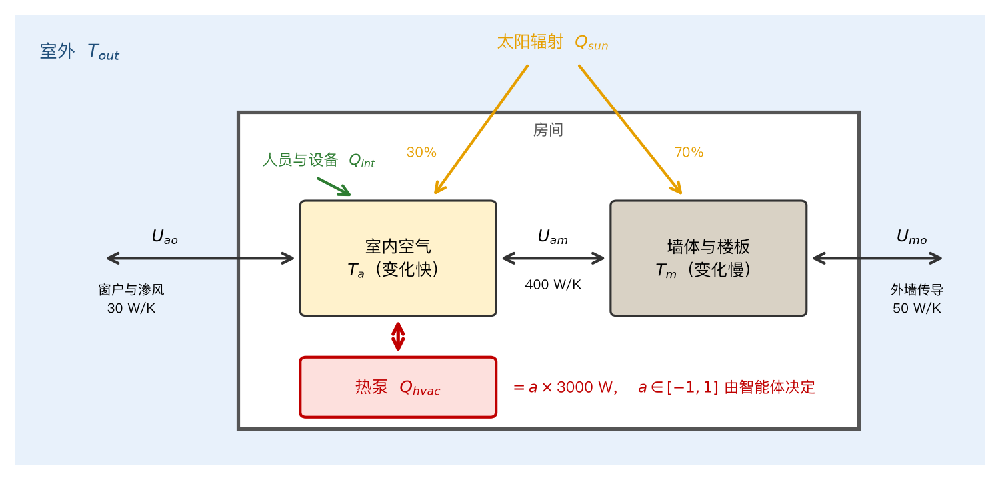
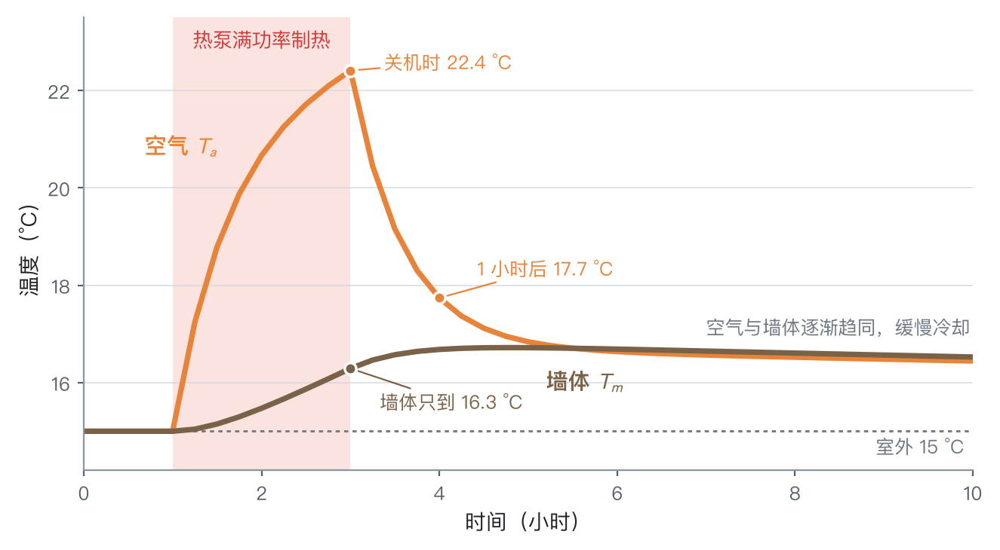
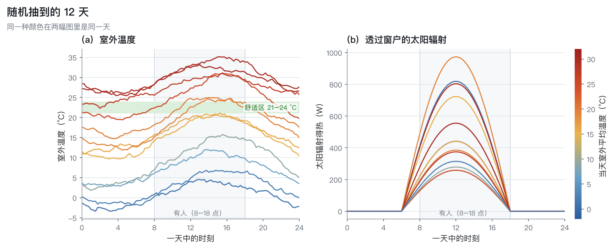
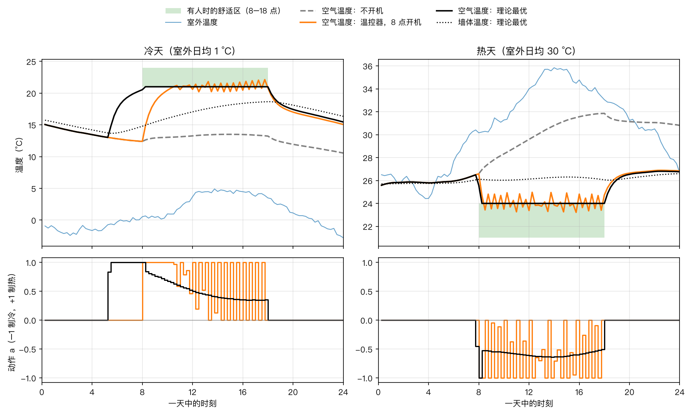

# 1 环境：一间房间和一台热泵

这一节介绍智能体要控制的对象：它面对的是什么、能做什么、做得好坏怎么算，以及这个问题对 PPO 难在哪里。
读者不需要建筑或暖通方面的背景。
观测向量、每步奖励的精确写法和训练设置放在第 2 节。

## 1.1 要解决的问题

设想一间约 30 m² 的办公室，装着一台既能制热也能制冷的热泵。
每天 8 点到 18 点有人上班，这段时间室温应保持在 21–24 °C（下文称“舒适区”）；其余时间没人，室温多少都可以。
热泵开得越大越费电。
智能体每 15 分钟决定一次热泵开多大，目标是全天用电尽量少，同时上班时间尽量不离开舒适区。

每天的天气不同，从日均 −2 °C 的冬天到日均 32 °C 的夏天都会遇到，所以同一个智能体既要会制热也要会制冷。

## 1.2 房间温度的数学模型

我们用两个温度描述房间：**空气温度** $T_a$ 和**墙体温度** $T_m$（墙和楼板合在一起）。
人感受到的是空气温度，舒适与否只看它。

两个温度随时间的变化由下面两个方程决定：

$$
\begin{aligned}
C_a\,\frac{dT_a}{dt} &= U_{ao}\,(T_{out}-T_a) \;+\; U_{am}\,(T_m-T_a) \;+\; Q_{hvac} \;+\; f\,Q_{sun} \;+\; Q_{int} \\[4pt]
C_m\,\frac{dT_m}{dt} &= U_{am}\,(T_a-T_m) \;+\; U_{mo}\,(T_{out}-T_m) \;+\; (1-f)\,Q_{sun}
\end{aligned}
$$

两个方程读法相同：左边是“这个物体升温有多快”，右边是“每秒流进它的热量”。
以第一个方程为例，流进空气的热量有五项：

1. $U_{ao}(T_{out}-T_a)$：通过窗户和缝隙与室外交换的热量。室外比室内冷时这一项是负的，即热量流失。
2. $U_{am}(T_m-T_a)$：与墙体交换的热量。墙比空气冷，空气就被墙“吸走”热量。
3. $Q_{hvac}$：热泵送进来的热量，制冷时为负。
4. $f\,Q_{sun}$：太阳辐射中直接加热空气的那部分。
5. $Q_{int}$：人和电脑等设备发出的热量。

**方程里只有 $Q_{hvac}$ 由智能体决定。**
智能体每一步输出一个数 $a\in[-1,1]$，热泵就按这个比例工作：

$$
Q_{hvac} = a \times 3000\ \text{W}, \qquad \text{耗电功率} = \frac{|a| \times 3000\ \text{W}}{3}
$$

$a=1$ 是满功率制热，$a=-1$ 是满功率制冷，$a=0$ 是关机。
分母的 3 是热泵的能效比：每用 1 份电可以搬运 3 份热量。
所以满功率时耗电 1 kW，一步（15 分钟）最多用 0.25 kWh。

注意 $Q_{hvac}$ 只出现在第一个方程里：热泵只能直接加热空气，墙体要靠空气慢慢带热。

各个量由谁决定，汇总如下：

| 符号 | 含义 | 取值 | 由谁决定 |
| --- | --- | --- | --- |
| $Q_{hvac}$ | 热泵送入空气的热量 | $a \times 3000$ W | **智能体** |
| $T_a$、$T_m$ | 空气温度、墙体温度 | 由方程算出 | 智能体只能通过 $Q_{hvac}$ 间接影响 |
| $T_{out}$ | 室外温度 | 每天不同，见 1.4 | 天气 |
| $Q_{sun}$ | 透过窗户的太阳辐射 | 0 到 1000 W | 天气 |
| $Q_{int}$ | 人和设备的发热 | 有人时 400 W，无人时 50 W | 作息时间表 |
| $C_a$、$C_m$ | 空气、墙体的热容 | $1\times10^6$、$1\times10^7$ J/K | 固定 |
| $U_{ao}$、$U_{am}$、$U_{mo}$ | 三条传热路径的传热系数 | 30、400、50 W/K | 固定 |
| $f$ | 太阳辐射直接加热空气的比例 | 0.3 | 固定 |

热容（J/K）是让物体升温 1 °C 需要的热量；传热系数（W/K）是两边每相差 1 °C 时每秒流过的热量。

智能体每 15 分钟决策一次，一步之内热泵功率和天气保持不变。
方程是线性的，所以一步之后的温度可以精确算出，没有数值积分误差。

## 1.3 这个模型为什么符合现实

**每一项都是基本的物理规律。**
方程左边是能量守恒：物体得到多少热量，就升多少温，热容越大升得越慢。
右边每一项“系数 × 温差”是传热的基本规律：两边温差越大，热量流得越快。
整个模型就是在给两个物体记热量的收支账。

**它能再现日常经验。**
下图是一个简单的试验：房间和室外都是 15 °C，热泵满功率开 2 小时然后关掉。

- 开机时空气升温很快，2 小时从 15 °C 升到 22.4 °C；墙体只升到 16.3 °C。
- 关机后空气在 1 小时内跌回 17.7 °C，向墙体温度靠拢。冬天进一间很久没人住的屋子，暖气吹着是暖的，一关就凉，就是这个现象。
- 墙体吸收的热量之后放得很慢：关机 7 小时后，空气和墙体都还有约 16.5 °C，高于室外。

模型里这两种快慢可以量化：空气对热泵的响应以约 0.6 小时为尺度，整个房间向室外温度靠拢以约 39 小时为尺度。

**建筑领域就是这样建模的。**
这类“几个热容加几条传热路径”的模型称为 RC 模型，是建筑控制研究的常用工具。
[Bacher 和 Madsen（2011）](https://doi.org/10.1016/j.enbuild.2011.02.005) 用一栋真实建筑 6 天的实测数据比较了不同复杂度的模型，结论是只用一个温度的模型明显不够，他们最终选出的模型有四个温度：室内、围护结构（外墙）、加热器、温度传感器。
我们保留了前两个，省略了后两个，相当于假设热泵的热量立刻送达、温度计读数准确。

**参数的量级合理，但不是实测值。**
各个参数是我们按量级手工设定的，没有用真实建筑的数据拟合。
粗略核对：30 m² 的房间约有 81 m³ 空气，热容约 $1\times10^5$ J/K，我们取的 $C_a$ 是它的 10 倍，因为把家具和墙面表层也算在“快”的那部分里；一块 30 m²、10 cm 厚的混凝土楼板热容约 $6\times10^6$ J/K，与 $C_m$ 同一量级。
室外 −2 °C 时，稳定地把室内维持在 21 °C 需要约 1.7 kW 的热量，热泵最大 3 kW，够用但余量不大。

**模型省略了什么。**

- 只有一个房间，没有邻室。
- 墙体只用一个温度表示；真实的墙内外有温差。
- 热泵能效固定为 3；真实热泵在室外越冷时效率越低。
- 不考虑湿度、通风和开窗。
- 天气是按公式生成的，不是真实气象数据。

这些省略让一次训练只需一分多钟，后面的对比实验才做得起来。
代价是结论只对这个简化的房间成立，不能直接搬到真实建筑。

## 1.4 一天是怎么生成的

一个回合是一天，从 0 点到 24 点，共 96 步。
每个回合开始时随机生成这一天的条件：

- **室外温度**：日均值在 −2 到 32 °C 之间均匀抽取；白天比夜里高 6 到 12 °C，下午 3 点最热；再叠加标准差约 1 °C 的随机波动。
- **太阳辐射**：6 点到 18 点之间有日照，正午最强；每天抽一个“晴朗程度”，最强时 200 到 1000 W。
- **初始温度**：0 点时的墙体温度取 $16.3 + 0.33 \times$ 当日室外均温，再加 ±1 °C 的随机偏差。冷天墙是凉的，热天墙是热的。这个公式的来源是让同一种天气连续重复 6 天，看午夜时墙体温度稳定在哪里。

## 1.5 好坏怎么衡量

每天记两个数：

- **耗电量**（kWh）：全天热泵用的电。
- **不舒适度**（K·h）：上班时间里，空气温度超出舒适区多少度，乘以持续的小时数，全天累加。例如上班时室温 20 °C（低 1 °C）持续 2 小时，记 2 K·h。无人时不计。

两者合成一个**成本**，越低越好：

$$
\text{成本} = \text{耗电量} + 2 \times \text{不舒适度}
$$

系数 2 的含义是：1 K·h 的不舒适和 2 kWh 的电一样糟，后者相当于热泵满功率开 2 小时。
智能体的奖励就是每一步成本的相反数。

为了让这些数字有参照，我们准备了几个不需要学习的控制器，在同一批 100 个测试日上比较：

| 控制器 | 做法 | 耗电量 kWh/天 | 不舒适度 K·h/天 | 成本 |
| --- | --- | --- | --- | --- |
| 不开机 | 热泵始终关闭 | 0.00 | 35.15 | 70.31 |
| 温控器，8 点开机 | 上班时间内，冷了就制热、热了就制冷 | 3.62 | 1.99 | 7.60 |
| 温控器，5 点开机 | 同上，提前 3 小时启动 | 4.25 | 0.60 | 5.45 |
| 温控器，3 点开机 | 同上，提前 5 小时启动 | 4.60 | 0.38 | 5.37 |
| 温控器，全天开 | 24 小时维持舒适区 | 6.17 | 0.23 | 6.64 |
| **温控器（调过参数）** | 5 点半开机；目标收在 22–23 °C，出力更平缓 | 4.24 | 0.12 | **4.48** |
| 理论最优 | 提前知道全天天气，直接解出最优的 96 个动作 | 3.49 | 0.00 | 3.49 |

温控器有三个参数：提前几小时开机、目标离舒适区边缘留多少余量、偏离目标时出力多大。
前几行只改了开机时间，后两个参数用的是随手定的值：低于 21.5 °C 开始制热，到 21 °C 时满功率。
最后一个温控器的三个参数是在另外 200 个日子上从 378 种组合里挑出来的（`scripts/tune_thermostat.py`），这 200 天既不是训练日也不是测试日。
它把目标收在 22–23 °C、出力也更平缓，成本比只调开机时间的最好结果（5.37）低了约六分之一。
**下文说“温控器”时，指的都是这个调过参数的版本。**

“理论最优”能算出来，是因为模型是线性的，在天气已知时求最优动作是一个标准的线性规划问题。
它提前知道全天的天气，而智能体只能看到当前的天气，所以它是任何控制器都不可能超过的下界，不是一个公平的对手。

图中冷天那一列最能说明问题：

- 8 点才开机的温控器（橙色）到 10 点半才把室温拉进舒适区，全天不舒适度 7.0 K·h。
- 理论最优（黑色）5 点 15 分就满功率开机，8 点时室温已到 20.5 °C，全天不舒适度为 0，而耗电只多了约 1 kWh（7.8 对 6.9）。
- 上班期间，理论最优让室温恰好停在 21 °C，也就是舒适区的下边缘，一度也不多加热。

## 1.6 为什么这样设计

**为什么把空气和墙体分开，各记一个温度。**
这里的“两个温度”就是 1.2 节的空气温度 $T_a$ 和墙体温度 $T_m$。
更简单的做法是把整个房间看成一个整体，只记一个室温 $T$：

$$
C\,\frac{dT}{dt} = U\,(T_{out}-T) + Q_{hvac} + \text{太阳和人员的得热}
$$

这样写只有一个热容 $C$ 可以选，而它取小取大都不像真实的房间。
我们把模型分别改成这两种情况，和本文的模型对比：

| 房间模型 | 满功率 15 分钟，室温升高 | 冷天不开机，8 点的室温 | 理论最优的不舒适度 |
| --- | --- | --- | --- |
| 只记一个温度，$C$ 取小（只算空气，墙体不储热） | 2.6 °C | 2.1 °C | 0.00 K·h |
| 只记一个温度，$C$ 取大（空气和墙体合为一体） | 0.25 °C | 13.4 °C | 0.21 K·h |
| 空气和墙体各记一个温度（本文） | 2.2 °C | 13.0 °C | 0.00 K·h |

- **$C$ 取小**：热泵一开室温就上来，但房间存不住热。冷天不开机，到早上 8 点室温已跌到 2.1 °C，而当时室外是 0.9 °C，几乎和室外一样冷。
- **$C$ 取大**：房间存得住热，但热泵满功率开 15 分钟室温只升 0.25 °C。即使提前知道全天天气，也无法完全保证舒适。
- **分开记**：空气升温快，墙体降温慢，两个特点同时具备。这也是 1.3 节那张开关机试验图里看到的现象。

把墙体单独记出来还带来一个后果：**同样的空气温度，需要的功率可以差很多，取决于墙体温度。**
在 1.5 节那张图的冷天里，理论最优在 9 点和 17 点 45 分都把空气维持在 21.0 °C，但 9 点需要 79% 的功率，17 点 45 分只需要 35%。
这期间墙体从 15.4 °C 升到了 18.6 °C，每秒从空气吸走的热量少了约 1.3 kW，功率的差别几乎全部来自这里。
只盯着空气温度的控制器看不到这个差别。

**为什么每天随机天气。**
如果天气固定，智能体只需要背下一条固定的动作序列。
随机天气迫使它学会根据当前情况做决定。

**为什么只在有人时要求舒适。**
这样夜里就有了“关机省电”的空间，也就产生了“什么时候重新开机”的问题。
舒适区 21–24 °C 取自建筑控制基准 BOPTEST 的一个测试案例（[Arroyo 等，2022](https://www.frontiersin.org/journals/built-environment/articles/10.3389/fbuil.2022.849754/full)）。
该案例在无人时仍要求 15–30 °C，我们简化为完全不作要求。

**为什么系数取 2。**
把耗电和不舒适度加权求和是这个领域的通行做法（例如 [Sinergym](https://sinergym.readthedocs.io/en/stable/pages/rewards.html) 的默认奖励）。
系数决定了两者的相对重要性。
在我们的房间里，系数取 2 时理论最优的不舒适度为 0，也就是说“舒适”相当于一个必须满足的要求，智能体出现的任何违规都是控制上的失误，而不是有意的取舍。
这让两个指标各有清楚的含义：不舒适度反映控制得准不准，耗电量反映省不省。

**为什么一个回合是一天。**
办公室的作息以天为周期，一天正好包含一次完整的“夜间关机、提前预热、白天维持、下班关机”。

## 1.7 对 PPO 的主要挑战

**挑战一：动作的好处来得晚。**
在 25 个冷天（日均低于 5 °C）里，理论最优平均在 5 点 40 分第一次开机，最早的一天是 3 点 15 分。
但不舒适的惩罚要到 8 点才开始计算。
在这之前的每一步，智能体只看到“开机要花电费”，预热的好处最多要等约 19 步之后才出现在奖励里。
PPO 需要把 8 点以后的好结果正确地归功于几个小时前的动作，这是信用分配问题，与 GAE 的参数 λ 直接相关。

**挑战二：最好的位置紧贴着惩罚的边缘。**
理论最优在 80% 的上班时间里，让室温停在舒适区边缘 0.05 °C 以内。
但边缘两侧的代价很不对称：往里多留 1 °C 的余量，每小时多花约 0.1 kWh（冷天 0.13，热天 0.09）；往外越界 1 °C，每小时罚 2 kWh，是前者的 16 到 21 倍。
PPO 靠给动作加随机噪声来探索，而满功率一步就能让空气温度变化 2.2 °C，动作上 0.1 的噪声对应约 0.2 °C 的温度抖动。
训练中的智能体因此会不断被噪声推出舒适区。它必须学会留多少余量，而余量又直接变成电费。

**挑战三：一个策略要应付所有天气。**
100 个测试日里，理论最优有 61 天只制热，37 天只制冷，2 天完全不开机。
最冷的一组日子平均用电 6.8 kWh，温和的日子只用 0.4 kWh。
也就是说，对一个已经学得不错的策略，各天成本的差别主要来自天气，而不是来自动作的好坏。
PPO 的价值网络必须先把“今天天气如何”这部分解释掉，剩下的才是判断动作好坏的信号。

**挑战四：学习的前后两段在优化不同的东西。**
不开机的成本是 70.31，全部来自不舒适度；理论最优的成本是 3.49，全部来自耗电。
训练早期，智能体只要学会“该开机”，成本就能从 70 降到个位数。
之后要从 7 左右降到 3.5，靠的是精确的预热时机和贴边控制，信号比早期小一个量级。

**挑战五：智能体看不到未来的天气。**
它只知道当前的室外温度和日照，不知道今天接下来会多冷、多晒。
凌晨决定是否预热时太阳还没出来，当天的晴朗程度无从得知。
所以即使训练得很好，它和理论最优之间也会留下一段无法消除的差距。这段差距有多大，我们没有测量。
