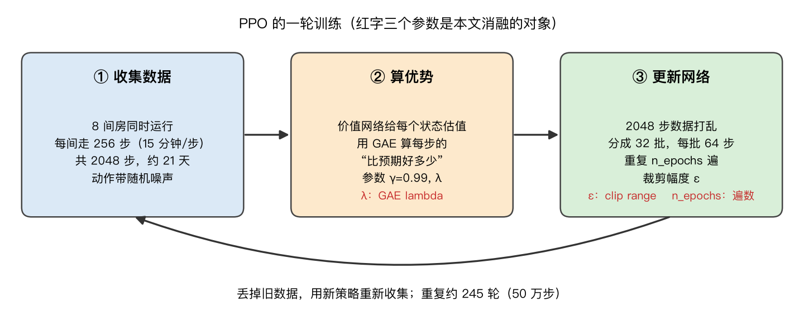

# 2 方法：MDP、PPO 与训练流程

这一节把第 1 节的房间写成一个强化学习问题（2.1），简要回顾 PPO 并指出本文要消融的三个参数各管什么（2.2），最后说明一次训练从开始到出结果的完整流程（2.3）。

## 2.1 MDP

| 要素 | 设定 |
| --- | --- |
| 观测 $s_t$ | 7 个数，见下表 |
| 动作 $a_t$ | 1 个数，$a_t\in[-1,1]$，热泵功率 $Q_{hvac}=3000\,a_t$ W（1.2 节） |
| 状态转移 | 1.2 节的两个方程，每步精确算出；天气按 1.4 节每天随机生成 |
| 奖励 $r_t$ | 这一步成本的相反数，见下 |
| 回合 | 一天，0 点到 24 点，96 步 |
| 折扣因子 | $\gamma=0.99$ |

### 观测

| 序号 | 内容 | 送进网络的数 | 为什么需要 |
| --- | --- | --- | --- |
| 1 | 空气温度 $T_a$ | $(T_a-22.5)/10$ | 舒适与否只看它 |
| 2 | 墙体温度 $T_m$ | $(T_m-22.5)/10$ | 维持同样的室温要多大功率，取决于它（1.6 节） |
| 3 | 室外温度 $T_{out}$ | $(T_{out}-15)/15$ | 房间往哪个方向漂、漂多快 |
| 4 | 太阳辐射 $Q_{sun}$ | $Q_{sun}/1000$ | 白天的免费热量 |
| 5 | 下一步是否有人 | 0 或 1 | 这一步是否计入不舒适 |
| 6、7 | 一天中的时刻 | $\sin$、$\cos(2\pi\cdot\text{小时}/24)$ | 知道离上班、下班还有多久 |

每个数都做了平移和缩放，让它们大致落在 −1 到 1 之间，神经网络更容易学。
例如一个日均 2.3 °C 的冬天，热泵一直不开，早上 7 点时智能体看到的是：

$$
s = [\,-0.89,\ -0.82,\ -0.93,\ 0.09,\ 0,\ 0.97,\ -0.26\,]
$$

即室温 13.6 °C、墙 14.3 °C、室外 1.0 °C、有一点阳光、还没上班。

观测里没有未来的天气。严格来说这让问题只是“部分可观测”的（1.7 节挑战五），但我们仍按 MDP 处理，不给智能体加记忆。

### 奖励

每一步的奖励是这一步成本的相反数：

$$
r_t = -\big(\,e_t + 2\,d_t\,\big), \qquad
e_t = 0.25\,|a_t|\ \text{kWh}, \qquad
d_t = \begin{cases} \text{dev}(T_{a,t+1}) \times 0.25\ \text{h} & \text{有人} \\ 0 & \text{无人} \end{cases}
$$

其中 $\text{dev}(T)=\max(21-T,\ T-24,\ 0)$ 是室温超出舒适区的度数，$T_{a,t+1}$ 是这一步结束时的空气温度。
$e_t$ 是这一步的耗电，$d_t$ 是这一步的不舒适度。
把一天 96 步的奖励加起来，正好是 1.5 节成本的相反数，所以“回报最大”和“成本最低”是同一件事。

奖励的量级：一步耗电最多 0.25 kWh。在 100 个测试日上，完全不开机时一天的回报平均约 −70；预实验中训练好的策略平均在 −4 到 −5 之间。

### 回合结束

24 点时回合**真正结束**：最后一步之后不再有任何奖励，也不需要估计“明天还值多少”。
这符合我们的目标，因为评估的是单日成本，而且观测里有时刻，智能体知道一天快结束了。

另一种做法是把 24 点当成“被截断”，这时 SB3 会把午夜状态的价值估计加进最后一步。
预实验里这样做的智能体会为“明天”保养房间：18 点下班后平均还用 0.44 kWh 电（真正结束时为 0.10），日均成本从 4.54 升到 5.19。

### 折扣因子

$\gamma=0.99$ 是 SB3 的默认值，本文不改。
1.7 节说过，预热动作的好处最多要等约 19 步才出现在奖励里；在 $\gamma=0.99$ 下，19 步之后的奖励仍保留 $0.99^{19}=0.83$ 的权重。
所以折扣本身不会让智能体“看不到”预热的好处。

## 2.2 算法：PPO

我们用 Stable-Baselines3 的 PPO，除了下面要消融的三个参数，其余都用默认值。

### 两个网络

- **策略网络**：输入 7 维观测，输出一个数 $\mu$。训练时动作从正态分布 $\mathcal{N}(\mu,\sigma^2)$ 中抽取，再截到 $[-1,1]$ 送给环境；$\sigma$ 是一个单独学习的参数，与状态无关，初始为 1。评估时直接用 $\mu$，不加噪声。
- **价值网络**：输入同样的观测，输出 $V(s)$，即“从这个状态开始，往后的折扣奖励总和预计是多少”。

两个网络各有两层 64 个神经元的隐藏层，激活函数为 tanh，不共享参数。

### 优势：这个动作比预期好多少（GAE，参数 λ）

先定义一步的“意外”：

$$
\delta_t = r_t + \gamma\,V(s_{t+1}) - V(s_t)
$$

它的意思是：这一步实际拿到的奖励加上下一个状态的估值，比原先对 $s_t$ 的估值多了多少。回合最后一步的 $V(s_{t+1})$ 取 0。

GAE 把从 $t$ 开始的意外按 $\gamma\lambda$ 逐步打折后加起来，作为动作 $a_t$ 的优势：

$$
\hat A_t = \delta_t + (\gamma\lambda)\,\delta_{t+1} + (\gamma\lambda)^2\,\delta_{t+2} + \cdots
$$

$\lambda$ 决定看多远的实际结果：

- $\lambda=0$：只看一步，$\hat A_t=\delta_t$。更远的影响全靠 $V(s_{t+1})$ 来代表。方差小，但 $V$ 估得不准时优势就不准。
- $\lambda=1$：$\hat A_t$ 等于到这天结束的实际折扣回报减去 $V(s_t)$。不依赖 $V$ 的准确程度，但一整天的随机性都混进来，方差大。

默认 $\lambda=0.95$ 时 $\gamma\lambda=0.94$，第 11 步以后的意外权重就不到一半（约 2.8 小时），19 步之后只剩 0.31：

| $\lambda$ | $\gamma\lambda$ | 权重降到一半所需步数 | 19 步后的权重 |
| --- | --- | --- | --- |
| 0.8 | 0.79 | 3 | 0.01 |
| 0.9 | 0.89 | 6 | 0.11 |
| 0.95（默认） | 0.94 | 11 | 0.31 |
| 0.99 | 0.98 | 35 | 0.68 |

需要注意，$\lambda$ 小并不等于智能体完全看不到远处的奖励：远处的信息仍然可以通过 $V(s_{t+1})$ 传回来，前提是价值网络已经学会了“8 点前房间暖不暖，对后面很重要”。

### 裁剪目标（参数 clip range，记作 ε）

一轮更新开始时，把收集数据所用的策略记为 $\pi_{old}$。对每条数据计算新旧策略的概率比：

$$
\rho_t = \frac{\pi_{new}(a_t \mid s_t)}{\pi_{old}(a_t \mid s_t)}
$$

PPO 最大化的目标是：

$$
L^{clip} = \text{平均}\Big[\min\big(\rho_t\,\hat A_t,\ \ \text{clip}(\rho_t,\,1-\varepsilon,\,1+\varepsilon)\,\hat A_t\big)\Big]
$$

读法：如果一个动作好于预期（$\hat A_t>0$），就提高它的概率，但概率涨到原来的 $1+\varepsilon$ 倍以后就不再有额外收益；差于预期的动作同理，降到 $1-\varepsilon$ 倍为止。
这样一轮更新不会把策略推得离收集数据的策略太远。默认 $\varepsilon=0.2$。

价值网络同时用均方误差拟合实际回报。总损失为 $-L^{clip} + 0.5 \times \text{价值误差}$。

### 每批数据用几遍（参数 n_epochs）

一轮收集到的 2048 步数据，打乱后分成 32 个小批次，每批 64 步，每批做一次梯度更新，这算一遍；默认重复 10 遍，共 320 次梯度更新。
遍数越多，从同一批数据里榨取的改进越多，但策略也越可能离 $\pi_{old}$ 太远，这时就要靠裁剪来刹车。

### 三个参数各管什么

| 参数 | 默认值 | 作用于 | 一句话 |
| --- | --- | --- | --- |
| GAE λ | 0.95 | 算优势 | 判断一个动作好不好时，看多远的实际结果 |
| clip range ε | 0.2 | 更新网络 | 一轮更新里，每个动作的概率最多变多少 |
| n_epochs | 10 | 更新网络 | 同一批数据用几遍 |

其余超参数都用 SB3 默认值，在所有实验里保持不变：

| 超参数 | 取值 |
| --- | --- |
| 学习率 | $3\times10^{-4}$，不衰减 |
| 每轮收集步数 | 2048（8 个环境 × 256 步） |
| 小批次大小 | 64 |
| 折扣因子 γ | 0.99 |
| 价值损失系数 | 0.5 |
| 熵奖励系数 | 0 |
| 梯度范数上限 | 0.5 |
| 优势归一化 | 每个小批次内归一化 |

## 2.3 训练流程

一次训练是上图三步的循环：

1. **收集数据。** 8 个房间同时运行，各走 256 步，共 2048 步，约合 21 天。每个房间一天结束后，立即换一个新的随机日接着跑。
2. **算优势。** 用价值网络和 GAE 给这 2048 步算出 $\hat A_t$。
3. **更新网络。** 按 2.2 节的方法更新策略网络和价值网络，然后丢掉这批数据，回到第 1 步。

每次训练 50 万步，即 245 轮、约 5,200 天。在一台 10 核笔记本上同时跑 8 次训练时，每次约需 85 秒。

### 评估

所有评估都用不加噪声的策略（直接取 $\mu$），在固定的测试日上进行。测试日和训练日用不同的随机种子生成。

- **训练过程中**：每 10 轮（20,480 步）在 30 个固定测试日上评估一次，得到学习曲线。SB3 还会在每轮更新后记录诊断量，其中 `approx_kl` 衡量这轮更新后策略变了多少，`clip_fraction` 是这轮被裁剪的数据占比，`explained_variance` 衡量价值网络拟合得多好。
- **训练结束后**：在 100 个固定测试日上评估，这是第 1 节对照控制器用的同一批日子，数字可以直接比较。

每组设置用 5 个随机种子各训练一次。种子影响网络的初始权重、训练时的动作噪声和训练日的天气。

### 报告的指标

| 作业要求 | 本文报告的量 |
| --- | --- |
| 舒适度违规 | 不舒适度（K·h/天）；违规比例：上班时间里室温超出舒适区 0.1 °C 以上的步数占比 |
| 能耗 | 耗电量（kWh/天） |
| 训练稳定性 | 5 个种子最终成本的差异；学习曲线在训练中的起伏；`approx_kl` 和 `clip_fraction` |

此外，把前两项合成的成本（耗电量 + 2 × 不舒适度）用作总体排名。训练稳定性具体用哪几个数来比较，在第 3 节结合实验设计给出。

### 软件

Python、Gymnasium 1.4.0、Stable-Baselines3 2.9.2、PyTorch 2.15.0，全部在 CPU 上运行。
环境代码在 `hvac/env.py`，训练入口在 `hvac/train.py`，评估在 `hvac/evaluation.py`。
