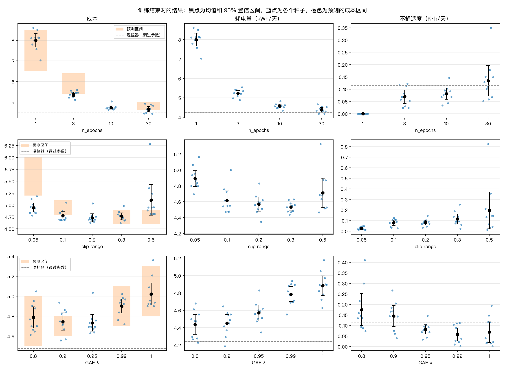
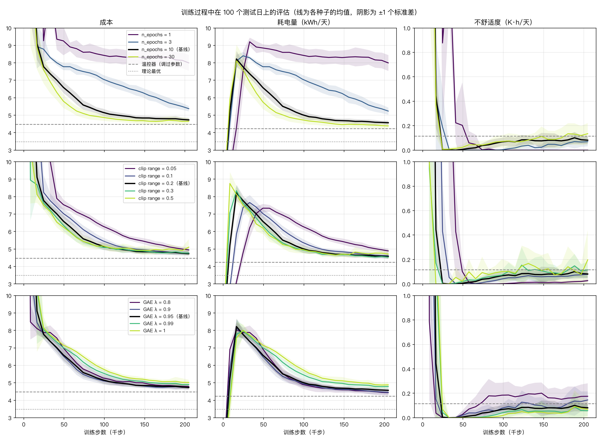
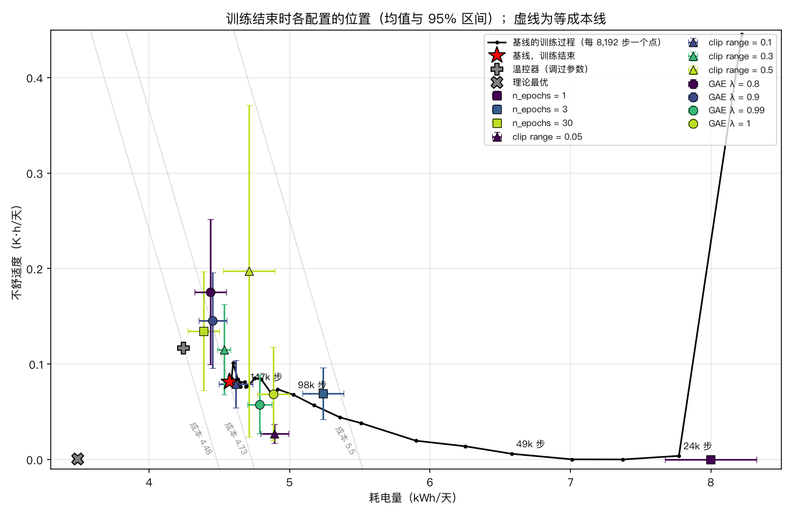

# 3 消融实验：先预测，再验证

> 状态：预测已于 2026-11-25 定稿并提交 git。提交时，除基线外的 11 种配置都还没有训练过。
>
> 修订（2026-11-25，仍在运行任何非基线配置之前，单独提交）：
>
> 1. 每种配置的种子数从 5 个增加到 10 个（3.1 节）。
> 2. 补充判定规则：每条预测怎样算命中、不命中或无法判断（3.1 节末、3.4 节末）。
> 3. 温控器换成调过参数的版本（成本 4.48，见 1.5 节）。原文里的“最好的温控器（5.37）”其实是没调过参数的版本，已改称“未调参的温控器”；预测的数值区间没有改动。
> 4. 去掉“追上温控器的步数”这个指标。学习速度只看学习曲线图，不做判定。
>
> 修订前的原文见 commit `8a7a3a4`。
>
> 结果（3.6 节）写于全部 120 次训练完成之后；3.1 到 3.5 节在此之后没有改动。

这一节回答作业的核心问题：clip range、GAE lambda 和 epochs 这三个参数，各自怎样影响舒适度违规、能耗和训练稳定性。
我们先写下预测和理由，再做实验。
预测写在前面有两个用处：读者可以检查我们对 PPO 的理解是否站得住；结果出来以后，和预测不一样的地方就是最值得分析的地方。

## 3.1 实验设计

每次只改一个参数，其余保持 SB3 默认值。加粗的是默认值，三个参数都取默认值的配置称为“基线”。

| 参数 | 取值 |
| --- | --- |
| clip range | 0.05、0.1、**0.2**、0.3、0.5 |
| GAE lambda | 0.8、0.9、**0.95**、0.99、1.0 |
| epochs | 1、3、**10**、30 |

共 12 种配置，每种配置用 10 个随机种子各训练一次，一共 120 次训练。
（预测写成时每种配置计划用 5 个种子，3.2 节和 3.4 节里基线的数字都来自当时的 5 个种子。）

**训练步数：204,800 步，即 100 轮更新。**
基线在这个步数下已经过了学得快的阶段（见 3.2 节），日均成本为 4.70，好于未调参的温控器（5.37），但还不如调过参数的温控器（4.48）。
它还没有学到头：预实验里继续训练到 50 万步是 4.54，150 万步是 4.23。
所以本节的结论说的是“同样给 20 万步数据，各个配置能学到哪里”。
学得慢的配置在 20 万步时还在半路上，实验无法回答它们最终能否追上。

**评估。**
每 4 轮更新（8,192 步）在 100 个固定测试日上评估一次，训练结束后在同样的 100 天上再评估一次。
评估时策略不加噪声。

**报告的指标。**

| 作业要求 | 指标 | 算法 |
| --- | --- | --- |
| 能耗 | 耗电量 | 训练结束时，100 个测试日的日均 kWh |
| 舒适度违规 | 不舒适度、违规比例 | 同上；K·h/天，以及上班时间里超出舒适区 0.1 °C 以上的步数占比 |
| 总体 | 成本 | 耗电量 + 2 × 不舒适度 |
| 训练稳定性 | 种子间差异 | 10 个种子最终成本的标准差 |
| 训练稳定性 | 训练中的回退 | 训练后半程（10.24 万步以后）的每个评估点，成本比此前所有评估点的最低值高出多少，取最大值；没有高出记 0 |
| 训练稳定性 | 每轮更新的幅度 | `approx_kl` 和 `clip_fraction`，每个种子先对各轮取平均 |
| 学习速度 | 学习曲线 | 只看图，不做判定（修订：原来的“追上温控器的步数”已去掉） |

SB3 每轮更新之后记录一次 `approx_kl` 和 `clip_fraction`，最后一轮的值不会写进日志，所以实际有 99 轮的记录。
`approx_kl` 只统计每轮最后一遍的小批次，遍数少时会偏小：1 遍时粗算只有整轮改动的三分之一左右，3 遍时约七成，10 遍和 30 遍时差别不大。
所以 epochs = 1 和 3 的 `approx_kl` 不和其他配置比较，本节也没有对它们做这方面的预测。

**判定规则（修订时补充）。**
每个种子训练一次，得到一个数；一个配置有 10 个这样的数。
判断某个配置和基线有没有差别，看两者均值之差的置信区间，用 Welch t 检验计算（它不要求两组的波动一样大）。
种子这么少时 bootstrap 区间不可靠（[Colas 等 2019](https://arxiv.org/abs/1904.06979)），所以不用它。

“差别不显著”不等于“相当”：种子少的时候，不显著可能只是因为看不清。
所以先规定一个可以忽略的差距 δ：

| 量 | δ | 理由 |
| --- | --- | --- |
| 成本、回退 | 0.1 | 约为基线成本的 2%；基线从 16.4 万步练到 20.5 万步，成本也只降了 0.076 |
| 耗电量 | 0.1 kWh | 与成本一致 |
| 不舒适度 | 0.05 K·h | 乘以权重 2 以后也是 0.1 |
| `approx_kl`、`clip_fraction` | 基线均值的 25% | 这两个量没有自然的单位，只用于“明显更高”这一种说法 |

每一种说法的判定方法：

| 预测的说法 | 命中 | 不命中 | 其余情况 |
| --- | --- | --- | --- |
| 数值区间，如“6.5 到 8.5”“低于 0.3” | 10 个种子的均值落在区间内 | 均值的 95% 区间与预测区间完全不重叠 | 部分命中：均值在区间外，但 95% 区间与它重叠 |
| 更高、略高（更低、略低同理） | 与基线之差的 95% 区间整个在 0 以上 | 整个在 0 以下 | 无法判断 |
| 明显更高 | 差值的 95% 区间整个在 δ 以上 | 整个在 δ 以下 | 无法判断 |
| 相当 | 差值的 90% 区间整个在 ±δ 以内 | 不满足命中条件，且 95% 区间不含 0 | 无法判断 |
| 不高于基线 | 差值 90% 区间的上端低于 δ | 不满足命中条件，且 95% 区间整个在 0 以上 | 无法判断 |
| 不低于基线 | 差值 90% 区间的下端高于 −δ | 不满足命中条件，且 95% 区间整个在 0 以下 | 无法判断 |
| 种子间差异更大 | 两组标准差之比经 F 检验显著（p < 0.05），且方向一致 | 显著，但方向相反 | 无法判断 |

“相当”和“不高于”用 90% 区间，是等价检验和非劣效检验的惯例：它等于在两端各做一次 5% 的单侧检验。
10 个种子对 10 个种子时，两组标准差之比要超过约 2.0 才算显著，所以“种子间差异更大”的预测很可能判不出来。

这里一共要比较几十次，即使所有配置都和基线一样，按 95% 的标准也会碰巧冒出一两个“显著”。
种子这么少，做 Bonferroni 校正以后几乎什么都判不出来，所以不做校正；单个勉强显著的结果，我们不当成强结论。

判定由 `scripts/analyze_ablation.py` 自动完成，每条预测怎么对应到上表，见 3.4 节末尾。

## 3.2 预测的出发点：基线是怎么学的

下面的预测主要不是从文献里的结论直接搬来的，而是从基线自己的训练记录推出来的。
所以先看基线。下表是 5 个种子的平均值。

| 训练步数 | 累计梯度更新次数 | 成本 | 耗电量 | 不舒适度 | 动作噪声 σ | `clip_fraction` |
| --- | --- | --- | --- | --- | --- | --- |
| 0 | 0 | 70.40 | 0.08 | 35.16 | 1.00 | |
| 8,192 | 1,280 | 16.63 | 5.12 | 5.75 | 0.99 | 3% |
| 24,576 | 3,840 | 7.76 | 7.76 | 0.00 | 0.79 | 6% |
| 40,960 | 6,400 | 6.93 | 6.93 | 0.00 | 0.49 | 6% |
| 65,536 | 10,240 | 5.97 | 5.94 | 0.02 | 0.26 | 6% |
| 98,304 | 15,360 | 5.21 | 5.08 | 0.07 | 0.15 | 7% |
| 147,456 | 23,040 | 4.85 | 4.66 | 0.10 | 0.09 | 10% |
| 204,800 | 32,000 | 4.70 | 4.56 | 0.07 | 0.06 | 13% |

`clip_fraction` 一列是从上一行到这一行之间各轮更新的平均值。

从这张表可以读出三件事，后面的预测都建立在它们之上。

**第一，学习分两段，两段付出的代价不同。**
前 2.5 万步，智能体学会“该开机”，不舒适度从 35 降到 0，但做得很浪费：耗电 7.76 kWh，比未调参的温控器（4.60）还多，调过参数的温控器只用 4.24。
之后的 18 万步都在省电：耗电从 7.76 降到 4.56，同时不舒适度从 0 小幅回升到 0.07 到 0.10。
省电靠的是把室温一点点推向舒适区的边缘，而越靠近边缘越容易越界。

由此得到一条通用的推论：**一个配置如果只是学得慢，它在 20 万步时就停在这条路的前面某处，表现为耗电更多、不舒适度更低。**
也就是说，“被拖慢”的配置舒适度违规反而更少。

**第二，省电阶段的进度和动作噪声 σ 绑在一起，而 σ 下降的速度受梯度更新次数限制。**
训练时动作要加噪声，噪声大就必须离舒适区边缘远一点，所以 σ 不降，电就省不下来。
σ 是一个单独的参数，Adam 每做一次梯度更新，大约最多把它的对数改变一个学习率的大小（$3\times10^{-4}$）。
基线每轮做 320 次梯度更新，所以一轮里 $\ln\sigma$ 最多下降约 0.096。
实际记录是：第 10 到 30 轮平均每轮下降 0.056，是这个上限的六成。
这说明在这一阶段，σ 几乎是在以优化器允许的最快速度下降。

**第三，在默认的 clip range 下，裁剪在前半程很少起作用。**
前 10 万步平均只有 6% 的数据被裁剪，`approx_kl` 在 0.004 到 0.008 之间。
到训练末尾，被裁剪的比例升到 13%，`approx_kl` 升到 0.012。
原因是 σ 变小以后，动作均值同样大小的改动，对应的概率变化更大。

## 3.3 预测

### epochs

**文献怎么说。**
PPO 原论文在不同任务上分别用了 3、10、15 遍（[Schulman 等 2017](https://arxiv.org/abs/1707.06347)）。
[Andrychowicz 等（2021）](https://arxiv.org/abs/2006.05990) 比较了 1、3、10 遍，结论是同一批数据用多遍对样本效率很关键；他们同时指出，优势只在每轮开始时算一次，用到后面几遍时已经过时，这会损害表现。
30 遍超出了这两篇文章试过的范围。

**我们的预测。**
按 3.2 节的第二点，遍数直接决定每轮能做多少次梯度更新，也就决定了 σ 一轮最多能降多少。

| epochs | 每轮梯度更新次数 | 100 轮后 σ 最低能到多少 |
| --- | --- | --- |
| 1 | 32 | 0.38 |
| 3 | 96 | 0.06 |
| 10 | 320 | 不构成限制 |
| 30 | 960 | 不构成限制 |

- **1 遍：远远学不完。** 即使 σ 每一步都以最快速度下降，20 万步后也还有 0.38；基线的 σ 在 0.38 时成本是 6.6。实际不会每一步都最快，所以预测最终成本在 6.5 到 8.5 之间，比未调参的温控器（5.37）差。耗电量明显更高，不舒适度接近 0。这一条把握最大。
- **3 遍：比基线差，大致追平未调参的温控器。** 总共 9,600 次梯度更新，基线做到这个次数时成本是 6.1。新数据上的更新比重复使用旧数据更有效，所以会比 6.1 好一些。预测成本在 5.4 到 6.4 之间，耗电更高，不舒适度低于基线。
- **30 遍：开头更快，最后不比基线好。** 前半程 σ 可以降得更快，所以追上未调参的温控器（5.37）的时间会明显提前（基线平均约 9 万步，预测 30 遍在 4 到 6 万步；修订：这一条只在学习曲线图上定性比较，不做判定）。但到 20 万步时不会有明显优势，预测成本在 4.6 到 5.0 之间。理由有两条。其一，基线从 20 万步到 50 万步只再降 0.16，这一段本来就没多少可赚。其二，同一批 2048 步数据用 30 遍，策略会去迎合这批数据里的偶然因素，每轮改动更大。预测 `approx_kl` 和 `clip_fraction` 都明显高于基线，训练中的回退更大；耗电略低于基线，不舒适度高于基线。

合起来：成本随遍数的变化是先陡降、后走平，1 到 10 遍收益很大，10 到 30 遍没有收益，而训练时间估计约为基线的 2.6 倍。

### clip range

**文献怎么说。**
PPO 原论文在 7 个机器人任务上比较了 0.1、0.2、0.3，归一化得分为 0.76、0.82、0.70，完全不裁剪时为 −0.39。
Andrychowicz 等的结论是 0.2 和 0.3 在所有任务上都还可以，0.1 或 0.5 在个别任务上更好。
[Engstrom 等（2020）](https://arxiv.org/abs/2005.12729) 指出裁剪并不能真正把概率比限制在范围内，一轮更新实际走多远取决于优化器。
照搬文献的话，预测应该是“0.2 附近最好，两边都变差”。

**我们的预测：往小了调会变差，往大了调基本没有影响。**

- **往大调（0.3、0.5）：和基线没有明显差别。** 按 3.2 节的第三点，基线前半程只有约 5% 的数据碰到裁剪，把界限放宽，这段时间几乎不会有任何变化。后半程有 10% 到 13% 的数据被裁剪，放宽后每轮改动会大一些，预测 `approx_kl` 升高但不到基线的 2 倍。预测两者的最终成本都在 4.6 到 4.9 之间，耗电和不舒适度也与基线相当。0.5 的种子间差异和回退可能略大，这一点把握不大。
- **往小调（0.05、0.1）：学得慢。** 基线前半程的 `approx_kl` 平均约 0.007，粗略对应一轮更新后动作概率的典型变化约 12%。界限取 0.05 时，预计一半以上的数据会碰到裁剪，每轮能走的距离被压到原来的一半甚至更少。按“只是学得慢”的推论，预测 0.05 的成本在 5.2 到 6.0 之间，耗电更高，不舒适度不高于基线，`clip_fraction` 超过 30%，`approx_kl` 降到 0.003 以下。0.1 介于两者之间，预测成本在 4.8 到 5.1 之间。

这个预测和 PPO 原论文不同的地方在于大的一端：原论文里 0.3 不如 0.2，不裁剪则完全失败。
我们认为本环境不会这样，依据是实测的 `clip_fraction` 很低：真正限制每轮改动幅度的是学习率，而不是裁剪。这和 Engstrom 等的观察一致。

### GAE lambda

**文献怎么说。**
GAE 原论文的结论是 lambda 在 0.9 到 0.99 之间通常最好（[Schulman 等 2016](https://arxiv.org/abs/1506.02438)）。
Andrychowicz 等比较了 0.8、0.9、0.95、0.99，结论是 0.9 在所有任务上都不错。
照搬文献的话，预测应该是“中间好，两头差”。

**本环境里的两种直觉。**

- 直觉一：小的 lambda 会学不会预热。预热的好处最多要等 19 步才出现在奖励里，lambda 取 0.8 时，19 步之后的“意外”权重只有 0.01。
- 直觉二：大的 lambda 噪声大。lambda 越大，一个动作的优势里混进的后续随机因素越多。

**我们的预测：直觉一不成立，直觉二成立。成本在 0.8 到 0.95 之间基本持平，0.99 和 1.0 变差。**

直觉一为什么不成立：lambda 小的时候，远处的好处并没有丢掉，而是由价值网络代为转达。
预热让房间更暖，价值网络对更暖的房间给出更高的估值，这个差别在下一步就进入了优势。
这要求价值网络估得准，而基线里 `explained_variance` 从 3.5 万步起一直在 0.95 以上。
而且默认的 0.95 本身也在依赖价值网络：它直接看到的只是随后十几步，再往后同样靠估值。
0.8 只是把“交给价值网络”的位置从大约 3 小时后提前到大约 1 小时后。
既然 0.95 能学会预热，0.8 也应该可以。

- **0.9：与基线相当**，成本在 4.6 到 4.8 之间。
- **0.8：与基线相当，但把握较小**，成本在 4.5 到 5.0 之间。可以单独检验的一点是它学会了预热：不舒适度应远低于 8 点才开机的温控器（1.99 K·h），预测在 0.3 K·h 以下。
- **0.99 和 1.0：比基线差，1.0 最差。** 粗略估算（假设各步的意外大小相同、互不相关，后面还有 40 步），lambda 取 1.0 时优势的噪声约为默认值的 1.8 倍，0.99 约为 1.5 倍；0.9 和 0.8 分别为 0.75 倍和 0.56 倍。噪声大，梯度的方向就不那么一致，σ 降得慢，省电阶段的进度也就慢。预测 0.99 的成本在 4.7 到 5.1 之间，1.0 在 4.8 到 5.3 之间，耗电高于基线，种子间差异和训练中的回退大于基线。它们的不舒适度是高是低，我们没有把握，不做预测。

## 3.4 预测汇总

基线是已知结果：成本 4.70（5 个种子的标准差 0.05），耗电 4.56 kWh，不舒适度 0.07 K·h，违规比例 2.0%，训练后半程的回退在 0.03 到 0.09 之间。
参照：温控器（调过参数）4.48，未调参的温控器 5.37，理论最优 3.49。

| 配置 | 最终成本 | 耗电量 | 不舒适度 | 训练稳定性 | 把握 |
| --- | --- | --- | --- | --- | --- |
| epochs = 1 | 6.5 到 8.5 | 明显更高 | 接近 0 | 曲线平滑；种子间差异更大 | 高 |
| epochs = 3 | 5.4 到 6.4 | 更高 | 更低 | 同上 | 中 |
| epochs = 30 | 4.6 到 5.0 | 略低 | 更高 | `approx_kl` 明显更高；回退更大 | 低 |
| clip = 0.05 | 5.2 到 6.0 | 更高 | 不高于基线 | `approx_kl` 低于 0.003；曲线平滑 | 中 |
| clip = 0.1 | 4.8 到 5.1 | 略高 | 相当 | 与基线相当 | 低 |
| clip = 0.3 | 4.6 到 4.9 | 相当 | 相当 | `approx_kl` 略高 | 中 |
| clip = 0.5 | 4.6 到 4.9 | 相当 | 相当 | `approx_kl` 不到基线 2 倍；回退可能略大 | 中 |
| lambda = 0.8 | 4.5 到 5.0 | 相当 | 低于 0.3 | 与基线相当 | 低 |
| lambda = 0.9 | 4.6 到 4.8 | 相当 | 相当 | 与基线相当 | 中 |
| lambda = 0.99 | 4.7 到 5.1 | 略高 | 不预测 | 回退略大 | 低 |
| lambda = 1.0 | 4.8 到 5.3 | 更高 | 不预测 | 种子间差异和回退更大 | 中 |

“种子间差异更大”在学得慢的配置上不代表训练不稳定。
基线在 6.5 到 8 万步、成本下降最快的时候，种子间的标准差是 0.24 到 0.27，到 20 万步才收窄到 0.05。
学得慢的配置在 20 万步时还处在下降最快的那一段。

三句话概括：

1. **epochs** 影响最大：1 遍和 3 遍明显学不完，30 遍没有额外收益。
2. **clip range** 只在调小时有影响，调大没有影响。
3. **GAE lambda** 调小没有影响，调大变差。

### 每条预测怎么判（修订时补充）

上表的说法按 3.1 节的判定规则逐条检验，对应关系如下。
表里没有、但 3.3 节正文里写了的可检验预测，也列了进来，标“正文”。
“不预测”的格子不检验；学习速度（3.3 节“30 遍开头更快”）只看图。

| 配置 | 检验的预测 |
| --- | --- |
| epochs = 1 | 成本在 6.5 到 8.5；耗电明显更高；不舒适度接近 0，即均值低于 0.05；曲线平滑，即回退不高于基线；种子间差异更大 |
| epochs = 3 | 成本在 5.4 到 6.4；耗电更高；不舒适度更低；回退不高于基线；种子间差异更大 |
| epochs = 30 | 成本在 4.6 到 5.0；耗电略低；不舒适度更高；`approx_kl` 明显更高；`clip_fraction` 明显更高（正文）；回退更大 |
| clip = 0.05 | 成本在 5.2 到 6.0；耗电更高；不舒适度不高于基线；`approx_kl` 低于 0.003；`clip_fraction` 高于 30%（正文）；回退不高于基线 |
| clip = 0.1 | 成本在 4.8 到 5.1；耗电略高；不舒适度相当；回退相当 |
| clip = 0.3 | 成本在 4.6 到 4.9；耗电相当；不舒适度相当；`approx_kl` 略高；`approx_kl` 不到基线的 2 倍（正文） |
| clip = 0.5 | 成本在 4.6 到 4.9；耗电相当；不舒适度相当；`approx_kl` 更高（正文）；`approx_kl` 不到基线的 2 倍；回退更大（把握不大）；种子间差异更大（正文，把握不大） |
| lambda = 0.8 | 成本在 4.5 到 5.0；耗电相当；不舒适度低于 0.3；回退相当 |
| lambda = 0.9 | 成本在 4.6 到 4.8；耗电相当；不舒适度相当；回退相当 |
| lambda = 0.99 | 成本在 4.7 到 5.1；耗电略高；回退更大；种子间差异更大（正文） |
| lambda = 1.0 | 成本在 4.8 到 5.3；耗电更高；回退更大；种子间差异更大 |

几点说明：

- 汇总表里的“训练稳定性：与基线相当”只用回退来检验。种子间差异没法用 10 个种子证明“相当”，所以不检验。
- “曲线平滑”同样只用回退来检验，判为“不高于基线”。
- “`approx_kl` 不到基线的 2 倍”按数值区间判，区间上端是基线 10 个种子 `approx_kl` 均值的 2 倍。
- 基线自己的数字会从 5 个种子更新为 10 个种子，所有比较都对 10 个种子的基线做。

## 3.5 这些预测最可能错在哪里

1. **“进度由梯度更新次数决定”可能说得太满。** 它来自基线的一段记录。1 遍和 3 遍时，每次梯度更新用的都是更新鲜的数据，效率可能比预想的高得多；如果是这样，3 遍的结果会比预测好。
2. **30 遍可能真的更好。** 如果本环境里重复使用数据的害处很小，30 遍在 20 万步时就相当于基线训练到 50 万步以后，成本可以到 4.5 左右。
3. **clip range 取 0.5 可能出事。** 我们的依据是“裁剪很少起作用”，但那是在有裁剪的情况下测到的。少数几次很大的更新被放开后会怎样，训练记录里看不出来。
4. **lambda 取 0.8 的依据最弱。** `explained_variance` 高，主要说明价值网络分得清“今天天气如何”，不能直接说明它分得清“房间暖 1 °C 值多少”，而后者才是预热所需要的。

## 3.6 结果

12 种配置 × 10 个种子共 120 次训练，单次 11 到 83 秒；新增的 115 次用 10 个进程并行，共用约 7 分钟。
原始结果单独提交在 commit `42917a8`，表格和图由 `scripts/analyze_ablation.py` 生成，关于 lambda 的分时段数字由 `scripts/lambda_time_of_day.py` 生成。

### 3.6.1 总表

| 配置 | 成本（均值 ± 标准差） | 与基线之差（95% 区间） | 耗电 kWh | 不舒适度 K·h | 违规比例 | 回退 | `approx_kl` | `clip_fraction` | 单次训练（秒） |
| --- | --- | --- | --- | --- | --- | --- | --- | --- | --- |
| 基线 | 4.73 ± 0.12 | — | 4.57 | 0.081 | 2.6% | 0.10 | 0.0091 | 8.9% | 31 |
| epochs = 1 | 8.00 ± 0.45 | +3.26 [+2.93, +3.60] | 8.00 | 0.000 | 0.0% | 0.53 | （0.0020） | 2.0% | 11 |
| epochs = 3 | 5.38 ± 0.15 | +0.64 [+0.51, +0.77] | 5.24 | 0.069 | 1.4% | 0.09 | （0.0043） | 4.0% | 17 |
| epochs = 30 | 4.66 ± 0.18 | -0.08 [-0.22, +0.07] | 4.39 | 0.135 | 4.0% | 0.24 | 0.0164 | 14.7% | 83 |
| clip = 0.05 | 4.95 ± 0.13 | +0.21 [+0.10, +0.33] | 4.89 | 0.027 | 0.7% | 0.02 | 0.0014 | 15.7% | 34 |
| clip = 0.1 | 4.77 ± 0.12 | +0.04 [-0.07, +0.15] | 4.62 | 0.079 | 2.1% | 0.03 | 0.0035 | 12.2% | 34 |
| clip = 0.3 | 4.76 ± 0.10 | +0.03 [-0.07, +0.13] | 4.53 | 0.115 | 3.6% | 0.20 | 0.0174 | 7.4% | 40 |
| clip = 0.5 | 5.11 ± 0.45 | +0.37 [+0.04, +0.70] | 4.71 | 0.197 | 4.9% | 0.57 | 0.0705 | 6.9% | 44 |
| lambda = 0.8 | 4.79 ± 0.15 | +0.05 [-0.07, +0.18] | 4.44 | 0.176 | 4.0% | 0.14 | 0.0111 | 10.7% | 37 |
| lambda = 0.9 | 4.74 ± 0.12 | +0.01 [-0.10, +0.12] | 4.45 | 0.145 | 4.2% | 0.17 | 0.0099 | 9.8% | 34 |
| lambda = 0.99 | 4.90 ± 0.10 | +0.17 [+0.07, +0.27] | 4.79 | 0.058 | 1.7% | 0.14 | 0.0077 | 7.6% | 34 |
| lambda = 1.0 | 5.02 ± 0.15 | +0.29 [+0.16, +0.42] | 4.88 | 0.069 | 1.9% | 0.13 | 0.0070 | 7.0% | 34 |

“与基线之差”是成本之差的 95% 区间（Welch t），区间不含 0 才算有差别。
回退的定义见 3.1 节。
epochs = 1 和 3 的 `approx_kl` 加了括号，因为它们只统计了每轮的最后一遍，会偏小（见 3.1 节），不能和其他行直接比。

先说三件和单个参数无关的事。

**基线比预测时看到的更分散。**
预测时用的 5 个种子（种子 0 到 4）是 4.70 ± 0.05；加上种子 5 到 9 以后，10 个种子是 4.73 ± 0.12。
多出来的波动几乎全部来自种子 5（5.04），去掉它，标准差回到 0.05。
5 个种子很容易碰不上一个坏种子，所以 3.4 节写的“基线标准差 0.05”低估了基线本身的波动。
这也说明把种子数加到 10 个是值得的。

**在 20 万步时，没有一种配置平均胜过调过参数的温控器（4.48）。**
120 次训练里只有 2 次做到了，都是 epochs = 30。
这和 3.1 节说的一致：20 万步时 PPO 还没学完，本节比较的是“同样的数据量下谁学得更快”。

**大多数配置并没有学到不同的东西，只是在同一条路上走得快慢不同。**
下图的黑线是基线训练过程中耗电和不舒适度的变化：先从右下（耗电高、几乎不越界）出发，往左走，越往左越省电，同时不舒适度慢慢升高。
各配置训练结束时的位置，大多就落在这条线上或它附近。

- epochs = 1、3，clip = 0.05，lambda = 0.99、1.0 落在基线终点的右边，也就是基线训练过程中更早的位置。3.2 节的推论“只是学得慢的配置，耗电更高、不舒适度更低”在这些配置上成立。
- epochs = 30 和 lambda = 0.8、0.9 落在基线终点的左上方：更省电，但更常越界。
- clip = 0.5 是唯一明显离开这条线的：耗电不比基线低，不舒适度却高得多（只是种子间差异太大，这两项都还不显著）。

按基线自己的学习曲线换算，可以说得更具体：clip = 0.05 的终点，基线在 12.7 万步就到了，相当于慢了约四成；epochs = 3 的终点，基线在 8.6 万步就到了。
这个换算的完整列表在 `scripts/analyze_ablation.py` 的输出里。

### 3.6.2 预测逐条核对

按 3.1 节的规则，54 条预测里命中 31 条，部分命中 3 条，不命中 5 条，无法判断 15 条。

无法判断的 15 条里，7 条是“相当”。10 个种子时，差值的 90% 区间半宽（各配置的中位数）在成本上是 0.10，耗电 0.11 kWh，不舒适度 0.04 K·h，和 δ 差不多大，所以只有差别非常接近 0 时才判得出“相当”。
另有 3 条是“种子间差异更大”，3.1 节已经说过这类预测很难判出来。
其余 5 条是方向预测（更高或更低），差别没有大到 10 个种子能看清。

所有预测的判定结果：

| 配置 | 指标 | 预测 | 实际 | 判定 |
| --- | --- | --- | --- | --- |
| epochs = 1 | 成本 | 6.5 到 8.5 | 8.00 [7.67, 8.32] | 命中 |
| epochs = 1 | 耗电量 | 明显更高 | 差 +3.43，95% 区间 [+3.1, +3.76] | 命中 |
| epochs = 1 | 不舒适度 | 接近 0（低于 0.05） | 0.000 [0.000, 0.000] | 命中 |
| epochs = 1 | 回退 | 曲线平滑（不高于基线） | 差 +0.435，90% 区间 [+0.214, +0.656] | 不命中 |
| epochs = 1 | 种子间差异 | 更大 | 标准差之比 3.93，p < 0.001 | 命中 |
| epochs = 3 | 成本 | 5.4 到 6.4 | 5.38 [5.27, 5.49] | 部分命中 |
| epochs = 3 | 耗电量 | 更高 | 差 +0.668，95% 区间 [+0.504, +0.831] | 命中 |
| epochs = 3 | 不舒适度 | 更低 | 差 -0.0122，95% 区间 [-0.0453, +0.0209] | 无法判断 |
| epochs = 3 | 回退 | 曲线平滑（不高于基线） | 差 -0.00231，90% 区间 [-0.0484, +0.0438] | 命中 |
| epochs = 3 | 种子间差异 | 更大 | 标准差之比 1.33，p = 0.408 | 无法判断 |
| epochs = 30 | 成本 | 4.6 到 5.0 | 4.66 [4.53, 4.78] | 命中 |
| epochs = 30 | 耗电量 | 略低 | 差 -0.183，95% 区间 [-0.319, -0.0465] | 命中 |
| epochs = 30 | 不舒适度 | 更高 | 差 +0.0532，95% 区间 [-0.0109, +0.117] | 无法判断 |
| epochs = 30 | approx_kl | 明显更高 | 差 +0.00728，95% 区间 [+0.00645, +0.00811] | 命中 |
| epochs = 30 | clip_fraction | 明显更高（正文） | 差 +0.0573，95% 区间 [+0.0513, +0.0633] | 命中 |
| epochs = 30 | 回退 | 更大 | 差 +0.141，95% 区间 [+0.0346, +0.247] | 命中 |
| clip = 0.05 | 成本 | 5.2 到 6.0 | 4.95 [4.85, 5.04] | 不命中 |
| clip = 0.05 | 耗电量 | 更高 | 差 +0.322，95% 区间 [+0.196, +0.448] | 命中 |
| clip = 0.05 | 不舒适度 | 不高于基线 | 差 -0.0543，90% 区间 [-0.0738, -0.0348] | 命中 |
| clip = 0.05 | approx_kl | 低于 0.003 | 0.0014 [0.0014, 0.0014] | 命中 |
| clip = 0.05 | clip_fraction | 高于 30%（正文） | 15.7% [15.5%, 15.9%] | 不命中 |
| clip = 0.05 | 回退 | 曲线平滑（不高于基线） | 差 -0.0781，90% 区间 [-0.105, -0.051] | 命中 |
| clip = 0.1 | 成本 | 4.8 到 5.1 | 4.77 [4.69, 4.86] | 部分命中 |
| clip = 0.1 | 耗电量 | 略高 | 差 +0.0456，95% 区间 [-0.0953, +0.187] | 无法判断 |
| clip = 0.1 | 不舒适度 | 相当 | 差 -0.00223，90% 区间 [-0.0281, +0.0236] | 命中 |
| clip = 0.1 | 回退 | 相当 | 差 -0.0634，90% 区间 [-0.0909, -0.0359] | 命中 |
| clip = 0.3 | 成本 | 4.6 到 4.9 | 4.76 [4.69, 4.84] | 命中 |
| clip = 0.3 | 耗电量 | 相当 | 差 -0.0368，90% 区间 [-0.117, +0.0437] | 无法判断 |
| clip = 0.3 | 不舒适度 | 相当 | 差 +0.0339，90% 区间 [-0.00722, +0.075] | 无法判断 |
| clip = 0.3 | approx_kl | 略高 | 差 +0.00837，95% 区间 [+0.00793, +0.00882] | 命中 |
| clip = 0.3 | approx_kl | 不到基线 2 倍（正文） | 0.0174 [0.0171, 0.0178] | 命中 |
| clip = 0.5 | 成本 | 4.6 到 4.9 | 5.11 [4.78, 5.43] | 部分命中 |
| clip = 0.5 | 耗电量 | 相当 | 差 +0.141，90% 区间 [-0.021, +0.303] | 无法判断 |
| clip = 0.5 | 不舒适度 | 相当 | 差 +0.116，90% 区间 [-0.0255, +0.257] | 无法判断 |
| clip = 0.5 | approx_kl | 更高（正文） | 差 +0.0615，95% 区间 [+0.048, +0.075] | 命中 |
| clip = 0.5 | approx_kl | 不到基线 2 倍 | 0.0705 [0.0571, 0.0840] | 不命中 |
| clip = 0.5 | 回退 | 更大（把握不大） | 差 +0.48，95% 区间 [+0.181, +0.779] | 命中 |
| clip = 0.5 | 种子间差异 | 更大（正文，把握不大） | 标准差之比 3.90，p < 0.001 | 命中 |
| lambda = 0.8 | 成本 | 4.5 到 5.0 | 4.79 [4.68, 4.89] | 命中 |
| lambda = 0.8 | 耗电量 | 相当 | 差 -0.133，90% 区间 [-0.246, -0.0211] | 无法判断 |
| lambda = 0.8 | 不舒适度 | 低于 0.3 | 0.176 [0.100, 0.252] | 命中 |
| lambda = 0.8 | 回退 | 相当 | 差 +0.0429，90% 区间 [-0.0101, +0.0958] | 命中 |
| lambda = 0.9 | 成本 | 4.6 到 4.8 | 4.74 [4.65, 4.83] | 命中 |
| lambda = 0.9 | 耗电量 | 相当 | 差 -0.118，90% 区间 [-0.222, -0.0138] | 无法判断 |
| lambda = 0.9 | 不舒适度 | 相当 | 差 +0.0641，90% 区间 [+0.0209, +0.107] | 不命中 |
| lambda = 0.9 | 回退 | 相当 | 差 +0.0752，90% 区间 [-0.0104, +0.161] | 无法判断 |
| lambda = 0.99 | 成本 | 4.7 到 5.1 | 4.90 [4.83, 4.97] | 命中 |
| lambda = 0.99 | 耗电量 | 略高 | 差 +0.216，95% 区间 [+0.0986, +0.334] | 命中 |
| lambda = 0.99 | 回退 | 更大 | 差 +0.0406，95% 区间 [-0.0389, +0.12] | 无法判断 |
| lambda = 0.99 | 种子间差异 | 更大（正文） | 标准差之比 0.85，p = 0.638 | 无法判断 |
| lambda = 1.0 | 成本 | 4.8 到 5.3 | 5.02 [4.91, 5.13] | 命中 |
| lambda = 1.0 | 耗电量 | 更高 | 差 +0.314，95% 区间 [+0.178, +0.449] | 命中 |
| lambda = 1.0 | 回退 | 更大 | 差 +0.0346，95% 区间 [-0.0784, +0.148] | 无法判断 |
| lambda = 1.0 | 种子间差异 | 更大 | 标准差之比 1.33，p = 0.412 | 无法判断 |

### 3.6.3 epochs：方向全对，但 3 遍比预想的好

1 遍完全符合预测：成本 8.00，在预测的 6.5 到 8.5 之内；耗电 8.00 kWh，不舒适度为 0。
训练结束时 σ 是 0.54，没有低于预测的下限 0.38。
它基本停在基线第 2.3 万步的位置，即刚学会“开机”、还没开始省电的阶段。

3 遍比预测的好：成本 5.38，略低于预测区间的下端 5.4。
3.3 节的推理是“进度由梯度更新次数决定”，3 遍一共做 9,600 次梯度更新，基线做到这个次数时（6.1 万步）成本是 6.11。
实际上 3 遍的终点，基线要到 8.6 万步（13,400 次梯度更新）才到。
按梯度更新次数算，3 遍的效率大约是基线的 1.4 倍，这正是 3.5 节第 1 条担心的情况。

σ 的记录说明了原因。
用 Adam 优化时，一次梯度更新最多把 $\ln\sigma$ 改变约一个学习率，可以拿这个上限衡量 σ 降得多“努力”：

| epochs | 梯度更新次数 | 训练结束时 σ | $\ln\sigma$ 实际下降 / 上限 |
| --- | --- | --- | --- |
| 1 | 3,200 | 0.54 | 0.65 |
| 3 | 9,600 | 0.20 | 0.56 |
| 10（基线） | 32,000 | 0.055 | 0.30 |
| 30 | 96,000 | 0.033 | 0.12 |

1 遍和 3 遍在整个训练中平均以上限的六成左右压低 σ，确实是被梯度更新次数卡住了，这一点和预测一致。
预测错在拿基线的进度作换算标准：基线前 10 轮（3,200 次梯度更新）σ 只从 1.0 降到 0.85，这段时间主要在学“该开机”；1 遍用同样多的梯度更新把 σ 降到了 0.54。
基线早期的梯度更新另有用途，所以“基线做到同样次数时在哪里”低估了 3 遍。

30 遍：成本 4.66，在预测区间 4.6 到 5.0 之内，比基线低 0.08，但差别不显著（区间 −0.22 到 +0.07）。
耗电比基线低 0.18 kWh，这一条显著；不舒适度高 0.05 K·h，没有显著。
`approx_kl` 是基线的 1.8 倍，`clip_fraction` 从 8.9% 升到 14.7%，训练后半程的回退从 0.10 升到 0.24，这三条预测都命中。
学习曲线上，30 遍在前半程明显领先：4.9 万步时 5.80，基线是 6.59；9.8 万步时 4.88，基线是 5.16。
之后差距缩小，到 20 万步只剩 0.08。
这和 3.3 节“开头更快，最后没有明显优势”的定性预测一致（按修订，这一条不做正式判定）。
代价是单次训练 83 秒，是基线（31 秒）的 2.7 倍，与预估的 2.6 倍接近。

### 3.6.4 clip range：往小调的影响比预想的小，往大调的影响比预想的大

这一组预测有 3 条不命中、2 条部分命中，是三个参数里错得最多的。

**裁剪比我们以为的更起作用。**
预测的依据是“基线只有约 9% 的数据被裁剪，所以裁剪很少起作用，真正限制每轮改动的是学习率”。
但实验结果是，每轮改动的幅度几乎跟着 clip range 成比例变化：

| clip range | `approx_kl` | 相对基线 | 每轮概率比的典型偏离 $\sqrt{2\,\text{KL}}$ | 与 clip range 之比 |
| --- | --- | --- | --- | --- |
| 0.05 | 0.0014 | 0.2 倍 | 0.053 | 1.06 |
| 0.1 | 0.0035 | 0.4 倍 | 0.084 | 0.84 |
| 0.2（基线） | 0.0091 | 1.0 倍 | 0.135 | 0.67 |
| 0.3 | 0.0174 | 1.9 倍 | 0.187 | 0.62 |
| 0.5 | 0.0705 | 7.8 倍 | 0.376 | 0.75 |

如果改动幅度真的只由学习率决定，这一列应该几乎不变；实际上从 0.05 到 0.5，`approx_kl` 差了 50 倍，而“典型偏离 / clip range”一直在 0.6 到 1.1 之间。
也就是说，每轮更新大致都走到裁剪边界附近才停下来，真正限制每轮改动的是 clip range，而不是学习率。
被裁剪的数据少，并不代表裁剪不起作用。一种解释是：越过边界的数据不再贡献梯度，剩下的数据推动力较弱，更新于是停在边界附近；`clip_fraction` 只数越过边界的数据，数不到停在边界附近的数据。
这个解释我们没有单独验证，但上表已经足以说明预测的前提是错的：基线的记录本身分不清“离边界很远”和“停在边界附近”，必须改变 clip range 才看得出来。

**0.05：慢了，但没有预想的慢。**
成本 4.95，比基线高 0.21（显著），但低于预测区间的下端 5.2，判为不命中。
`clip_fraction` 只有 15.7%，远低于预测的“超过 30%”。
耗电更高、不舒适度更低、曲线平滑，这些方向都对：它停在基线 12.7 万步的位置，σ 是 0.11（基线 0.055），就是一个“只是学得慢”的配置。
错的是程度：每轮概率比的典型偏离只有基线的四成（0.053 对 0.135），进度却有基线的六成（12.7 万步对 20.5 万步）。
一种可能是基线每轮的改动里有一部分在来回抵消，改动小的配置浪费得少；clip = 0.05 和 0.1 的回退远小于基线（0.02、0.03 对 0.10）与此相符，但我们没有直接验证。

**0.1：和基线没有可分辨的差别。**
成本 4.77，比基线高 0.04（不显著），略低于预测区间 4.8 到 5.1，判为部分命中。
回退比基线小，不舒适度相当，都命中。

**0.3：成本和基线一样，回退变大。**
成本 4.76，命中；`approx_kl` 是基线的 1.9 倍，命中“略高、不到 2 倍”。
耗电和不舒适度的差别都不显著，但也没窄到能判为“相当”。
有一条没有预测到：回退从 0.10 升到 0.20（差值的 95% 区间 +0.01 到 +0.21，勉强显著）。

**0.5：出了问题，这是 3.5 节第 3 条担心的情况。**
成本 5.11，比基线高 0.37（95% 区间 +0.04 到 +0.70），种子间的标准差是基线的 3.9 倍，回退 0.57，是基线的 6 倍。
10 个种子的最终成本里，7 个在 4.81 到 4.95 之间，另外 3 个是 5.24、5.35 和 6.28；最差的那个在 15.6 万步时还是 4.79。
10 个种子里有 7 个的回退超过 0.4，基线平均只有 0.10。
`approx_kl` 平均是基线的 7.8 倍，判为不命中“不到 2 倍”。
单轮的 `approx_kl` 最大达到 2.2，10 个种子一共有 110 轮超过 0.1；其他所有配置里，只有 0.3 有 2 轮超过 0.1。

0.5 的学习曲线说明了它是怎么出问题的：前半程它比基线快（4.9 万步时 6.25，基线 6.59），到 14.7 万步还和基线差不多（4.93 对 4.84），然后不再进步，反而开始来回波动。
它的 `approx_kl` 也是后期大：第 2 到 30 轮平均 0.032，第 71 到 100 轮平均 0.13（基线分别是 0.007 和 0.012）。
我们推测，训练后期策略已经贴着舒适区边缘运行（3.2 节），这时一次大的改动就可能让室温越界：最差的种子最终不舒适度是 0.83 K·h，是基线的 10 倍。

**和文献对比。**
PPO 原论文在机器人任务上得到“0.2 最好，0.1 和 0.3 都差一些”。
在我们的环境里，0.1、0.2、0.3 的成本没有可分辨的差别，往小调到 0.05 只是学得慢，往大调到 0.5 才出问题。
在这一点上，我们“往大调没有影响”的预测只对了 0.3，0.5 是错的；文献“两边都变差”的说法在 0.05 和 0.5 上成立。
Engstrom 等指出裁剪并不能真正把概率比限制在 $1\pm\varepsilon$ 以内。我们也看到了这一点：如果所有数据的概率比都在 0.5 到 1.5 之间，`approx_kl` 最多约 0.19，而 0.5 的单轮 `approx_kl` 最大到了 2.2。

### 3.6.5 GAE lambda：成本的预测全部命中，但对耗电和不舒适度的拆分是错的

五个取值的成本都落在预测区间内：0.8、0.9 和基线没有可分辨的差别，0.99 和 1.0 更差，1.0 最差（比基线高 0.29，显著）。
0.99 和 1.0 耗电更高，也都命中。
“0.8 学得会预热”也成立：不舒适度 0.18 K·h，远低于 8 点才开机的温控器（1.99）。

但预测说 0.8 和 0.9 的耗电和不舒适度与基线“相当”，这没有成立。
实际上，从 0.8 到 1.0 大体是一个连续的变化：lambda 越小，越省电、越常越界（0.99 和 1.0 之间的差别已经分不清）。
0.9 的不舒适度比基线高 0.064 K·h，判为不命中；0.8 高 0.094 K·h（95% 区间 +0.017 到 +0.172）。
两者的耗电都低约 0.12 到 0.13 kWh，接近显著。
省下的电和多出的不舒适度乘以权重 2 以后大致抵消，所以成本没有变化。

为了看清 lambda 改变了什么，我们把 100 个测试日按时段拆开（10 个种子的平均）：

| | 8 点前耗电 | 8–18 点耗电 | 18 点后耗电 | 8–10 点不舒适度 | 10–18 点不舒适度 | 冷天不舒适度 | 热天不舒适度 |
| --- | --- | --- | --- | --- | --- | --- | --- |
| 理论最优 | 0.64 | 2.85 | 0.00 | 0.000 | 0.000 | 0.001 | 0.000 |
| 温控器（调过参数） | 1.31 | 2.93 | 0.00 | 0.066 | 0.051 | 0.173 | 0.191 |
| lambda = 0.8 | 1.20 | 3.07 | 0.16 | 0.109 | 0.066 | 0.368 | 0.186 |
| lambda = 0.9 | 1.45 | 2.86 | 0.14 | 0.057 | 0.088 | 0.233 | 0.235 |
| lambda = 0.95（基线） | 1.58 | 2.84 | 0.15 | 0.035 | 0.046 | 0.163 | 0.094 |
| lambda = 0.99 | 1.92 | 2.64 | 0.22 | 0.025 | 0.033 | 0.097 | 0.088 |
| lambda = 1.0 | 2.00 | 2.63 | 0.25 | 0.027 | 0.041 | 0.083 | 0.143 |

耗电单位 kWh/天，不舒适度单位 K·h/天；冷天指日均气温低于 10 °C，热天指不低于 22 °C。

规律很清楚：**lambda 越大，8 点前预热用的电越多。**
从 0.8 到 1.0，8 点前的耗电从 1.20 升到 2.00 kWh，上班时间的耗电反而略降（3.07 到 2.63）。
0.8 的不舒适度集中在上班的头两个小时（按每小时算，是 10 点以后的 6 倍多）和冷天，也就是预热不足。
这说明 3.3 节的直觉一有一部分是对的：0.8 确实学会了预热，但预热得不够，在冷天的早上吃亏。
价值网络能转达远处的好处，但转达得不完整。

反过来，lambda 大的配置预热得太多：理论最优在 8 点前只用 0.64 kWh，基线已经用了 1.58，1.0 用了 2.00。
这一项多花的电比上班时间省下的多，所以 0.99 和 1.0 的总耗电更高。
我们预测 0.99 和 1.0 变差的理由是“优势估计的噪声大，σ 降得慢”。
σ 确实降得慢（训练结束时 0.069 和 0.078，基线 0.055），这一条理由站得住。
但它们具体差在哪里，是“预热过多”，这是我们没有预料到的。
一个可能的解释是：lambda 越大，预热的好处越直接地进入早上动作的优势，策略学到“多预热有好处”更快，但还没学会“预热到多少为止”。这个解释没有经过检验。

另外，表里这 5 组 PPO 策略在 18 点下班后都还在用电（0.14 到 0.25 kWh），理论最优和温控器在这段时间都不开机。
这部分电纯属浪费，说明 20 万步时 PPO 还没学会“下班就关机”。

### 3.6.6 训练稳定性

作业要求报告训练稳定性。把三个指标放在一起看：

- **种子间差异**：只有 epochs = 1 和 clip = 0.5 显著大于基线（标准差都约为基线的 3.9 倍）。其余 9 种配置的标准差是基线的 0.85 到 1.53 倍，10 个种子分辨不出差别。
- **训练中的回退**：除 epochs = 1 外，回退的大小基本跟着 `approx_kl` 走。每轮改动最小的 clip = 0.05 和 0.1 回退最小（0.02、0.03），改动最大的 clip = 0.5 回退最大（0.57），epochs = 30（0.24）和 clip = 0.3（0.20）居中。
- **每轮更新的幅度**：见 3.6.4 节，主要由 clip range 决定；epochs = 30 也使它升高到基线的 1.8 倍。

epochs = 1 是个例外：它每轮改动很小，回退却有 0.53，是预测里“曲线平滑”不命中的那一条。
原因在于回退的定义：它衡量的是“比此前最好的成绩差多少”。
基线在后半程还在稳定下降，偶尔的波动会被下降抵消；epochs = 1 在后半程几乎走平，评估成本每 8,192 步平均变化 0.14（基线 0.06），每一次波动都会被记成回退。
它在后半程的 σ 还有 0.5 到 0.8，训练数据噪声很大，为什么动作均值会在相邻两次评估之间变化这么多，我们没有查清。
可以确定的是，epochs = 1 的“回退”反映的是“还没学好、在原地晃”，而不是“学好了又被破坏”，和 clip = 0.5 的回退性质不同。
我们在预测时没有想到这个指标会把这两种情况混在一起。

### 3.6.7 总结：哪些预测对了，哪些错了，错在哪里

| 参数 | 预测的核心说法 | 结果 |
| --- | --- | --- |
| epochs | 1、3 遍学不完，30 遍没有额外收益 | 对。3 遍比预想的好一些：每次梯度更新的效率比基线高 |
| clip range | 往小调变差，往大调没有影响 | 一半对。0.05 变差，但差得比预想的少；0.3 没有影响，0.5 不稳定 |
| GAE lambda | 0.8 到 0.95 持平，0.99、1.0 变差 | 成本对，原因的拆分不对：lambda 控制的是“预热多少”，小了预热不足、大了预热过多 |

错得最多的地方有两个，都可以追溯到 3.2 节对基线的解读：

1. **“裁剪很少起作用”是误读。** 被裁剪的数据少，是因为每轮更新恰好停在边界附近。基线的记录本身无法区分这两种情况，必须改变 clip range 才看得出来。
2. **“进度由梯度更新次数决定”只在梯度更新次数真正不够时成立。** 在 1 遍和 3 遍上它成立，但不能用基线的进度来换算，因为基线早期的更新另有用途。

在作业关心的三个指标上：

- **能耗**：影响最大的是 epochs（1 遍比基线多用 75%）。此外 lambda 越大耗电越高；clip range 在 0.05 到 0.3 之间越小耗电越高。
- **舒适度违规**：凡是“学得慢”的配置，违规都更少。clip range 越大违规越多（违规比例从 0.7% 到 4.9%）；lambda 取 0.8 和 0.9 时违规比例约 4%，基线是 2.6%。没有一个配置在耗电和不舒适度上同时好于基线。
- **训练稳定性**：clip range 是主要因素。0.5 是唯一真正不稳定的配置，0.05 和 0.1 比基线更平稳，但学得更慢。

## 3.7 事后分析：clip range 怎样改写梯度和更新轨迹

> 本节是在看到 3.6 节结果之后设计的加记录重训。3.1–3.6 节和 54 条预测的判定沿用原文，本节新增对梯度、参数运动和探索噪声的机制分析。

### 3.7.1 实验与记录

重跑 clip range = 0.05、0.1、0.2、0.3、0.5，另外重跑 epochs = 1 和 3。每种配置用种子 0–2，共 21 次训练；每次 204,800 步、100 轮更新。每轮 2,048 条数据，每遍 32 个小批。

[带记录的 PPO](<../../../hvac/diagnostics.py>)复制 SB3 2.9.2 的训练循环，在每个小批更新前后做只读测量：计算裁剪分类、反事实梯度、梯度范数、参数步长和相邻步方向；每遍汇总小批梯度一致性、整批解析 KL 与概率比分布；每轮记录路径和净位移。记录以每遍、每轮的汇总保存，默认训练使用关闭的诊断开关。

**21 次训练全部复现原消融。** 训练日志数值、整条评估曲线、最终 100 天逐日结果和均值一致，最终策略参数与 Adam 状态逐张量一致。运行耗时单独记录。[自动验证结果](<../data/clip_diagnostics_verification.json>)保留了每次检查、版本和源码哈希。

原始记录见[诊断运行目录](<../../../runs/diagnostics/>)，表格、图和数值输出由[分析脚本](<../../../scripts/analyze_clip_diagnostics.py>)生成。
以下主要比较**后期第 71–100 轮、三个种子的平均**；梯度范数裁剪触发率和 epochs 对比使用全程记录。这个后期窗口的基线 `clip_fraction` 为 13.2%。

### 3.7.2 约 7% 的数据把基线梯度方向转了 40°

PPO 的目标裁剪按概率比处理样本，梯度范数裁剪则把策略网络和价值网络的联合梯度范数压到 0.5。本小节先测目标裁剪怎样改变策略梯度。

SB3 的 `clip_fraction` 统计 $|r-1|>\varepsilon$ 的全部样本。朝优势所指方向越界的样本，其策略梯度被置零；朝相反方向越界的样本，梯度继续把概率往回拉。基线后期的两类样本分别约为 7.0% 和 6.1%。

在同一个小批、同一组参数上计算三个梯度：

$$
g_u=\nabla_\theta[-\operatorname{mean}(A r)],\qquad
g_z=\nabla_\theta[-\operatorname{mean}(A r\,w)],\qquad
g_c=g_u-g_z.
$$

$g_u$ 使用无目标裁剪的损失，$g_c$ 是实际策略梯度，$g_z$ 是被删去的部分。$A$ 按 SB3 的小批方式归一化；$w$ 取实际 autograd 分支删去的权重，完整置零时为 1，保留梯度时为 0，浮点边界的半梯度按对应权重计算。

| clip range | σ | 越界比例（SB3 的 `clip_fraction`） | 其中梯度被置零 | 其中仍在往回拉 | 被置零数据的梯度长度 / 无裁剪梯度长度 | 被置零数据沿无裁剪梯度方向的份额 | 实际梯度与无裁剪梯度的夹角 |
| --- | --- | --- | --- | --- | --- | --- | --- |
| 0.05 | 0.157 | 20.3% | 11.3% | 9.0% | 79% | 28% | 约 49° |
| 0.1 | 0.092 | 16.6% | 8.9% | 7.7% | 68% | 22% | 约 43° |
| 0.2 | 0.068 | 13.2% | 7.0% | 6.1% | 59% | 19% | 约 40° |
| 0.3 | 0.060 | 11.1% | 6.0% | 5.1% | 53% | 18% | 约 37° |
| 0.5 | 0.054 | 10.9% | 6.1% | 4.8% | 47% | 18% | 约 35° |

长度比计算为 $\|g_z\|/\|g_u\|$，方向投影份额为 $g_z^\top g_u/\|g_u\|^2$，各小批先算，再平均。夹角由平均方向余弦换算。

**基线约 7% 的置零数据，贡献了相当于无裁剪梯度 59% 的合成长度、19% 的方向投影，并让实际梯度转向约 40°。** 目标裁剪在这套训练中的作用同时包含长度削减和方向改写。

收紧到 0.05 后，置零比例升到 11.3%，删去梯度的长度比升到 79%，方向投影升到 28%，转向角升到 49°。这些量沿着同一方向变化：小 clip 对策略梯度的删改更强。

### 3.7.3 实际训练轨迹中的小批梯度共同方向

对一遍内依次遇到的 32 个小批梯度，计算

$$
C=\frac{\|\overline g\|^2}{\operatorname{mean}_k\|g_k\|^2}.
$$

$C$ 衡量平均梯度相对于各小批尺度的强度，综合小批方向和长度的波动。归一化离散程度由下面的恒等式得到：

$$
\frac{\operatorname{mean}_k\|g_k-\overline g\|^2}{\operatorname{mean}_k\|g_k\|^2}=1-C.
$$

这是沿实际参数更新轨迹测得的小批序列一致性。图中同时画出互不相关、零均值向量的参考尺度 $1/32$。

| clip range | 小批梯度一致性：实际使用 | 不带裁剪 | 第 1 遍后已走完全轮 KL 的 | 一轮内参数走过的路径长度 | 净位移 | 净位移 / 路径 |
| --- | --- | --- | --- | --- | --- | --- |
| 0.05 | 0.012 | 0.051 | 63% | 1.15 | 0.101 | 0.09 |
| 0.1 | 0.013 | 0.031 | 69% | 1.17 | 0.112 | 0.10 |
| 0.2 | 0.015 | 0.032 | 67% | 1.20 | 0.128 | 0.11 |
| 0.3 | 0.016 | 0.034 | 78% | 1.23 | 0.143 | 0.12 |
| 0.5 | 0.020 | 0.037 | 37% | 1.29 | 0.193 | 0.15 |

**每种配置中，目标裁剪都降低了小批梯度一致性。** 基线从无目标裁剪的 0.032 降到实际的 0.015；0.05 从 0.051 降到 0.012。随着 clip 放宽，实际梯度一致性从 0.012 升到 0.020，归一化离散程度随之下降。

方向测量也呈现同一现象：基线的小批梯度与该遍平均梯度之间的平均方向余弦，从无目标裁剪的 0.155 降到实际的 0.069。五个 clip 的实际方向余弦集中在 0.069–0.076。裁剪删去部分梯度后，小批之间的共同方向信号被显著削弱。

### 3.7.4 参数先迅速拉开策略距离，再沿弯曲路径调整

基线第 1 遍结束时的整批解析 KL 为 0.0083，第 10 遍为 0.0123。第一遍已经形成整轮终点 KL 的 67%，后续迭代在这一距离上继续调整，并出现局部回摆。

策略参数一轮累计走过约 1.20 的路径，只留下约 0.128 的净位移，净位移/路径约 0.11；相邻两步方向余弦约 0.86。这描绘出**连续转弯、长路径和小净位移**的更新形态。

大 clip 的后续遍数继续累积较多变化：0.5 的 KL 从第 1 遍的 0.0536 升到第 10 遍的 0.1450。五个 clip 的整轮终点 KL 依次为 0.0017、0.0043、0.0123、0.0248、0.1450，参数净位移也从 0.101 增到 0.193。

再看样本在概率比边界附近的位置。每遍结束后，在整批状态上计算

$$
u=\operatorname{sign}(A)\frac{r-1}{\varepsilon}.
$$

这里 $A$ 在整批上归一化，$u>0$ 表示朝有利方向变化，$u>1$ 表示越过有利边界。基线一轮末尾的分布是：

| 有利方向的位置 | 样本比例 | 除以区间宽度后的密度 |
| --- | --- | --- |
| $0<u\leq0.5$ | 33.9% | 0.677 |
| $0.5<u\leq0.8$ | 7.3% | 0.242 |
| $0.8<u\leq1$ | 3.1% | 0.153 |
| $u>1$ | 8.1% | 无限宽区间 |

**样本主体集中在较小的有利变化区间，密度向边界方向逐步降低。** 其余四个 clip 也呈现这种形态，边界内侧 $0.8<u\leq1$ 的比例约为 3%–4%。结合长路径和小净位移的记录，一轮更新表现为：少量越界样本的梯度被删改，参数继续沿弯曲路径运动，累计净变化随 clip 的尺度而变。

从单轮走到多轮，累计模式发生了转换。一轮内部的净位移/路径随 clip 放宽从 0.09 升到 0.15；连续十轮的参数净位移/各轮位移长度之和则从 0.486 降到 0.358，基线为 0.418。相邻两轮的方向余弦依次为 0.109、0.074、0.062、0.072、0.032。

小 clip 的单轮净变化较小，多轮之间的同向累计比例较高。动作均值的十轮累计量也呈现相近的排列：0.425、0.311、0.289、0.266、0.268。这个量的分子在当前整批状态上计算，分母汇总各轮在本轮状态上的改动。

### 3.7.5 梯度范数裁剪是常驻环节，放宽 clip 后压缩力度增加

SB3 对策略网络和价值网络的联合梯度做范数裁剪，阈值为 0.5。实际保留系数为

$$
s=\min\left(1,\frac{0.5}{\|g_{\text{total}}\|+10^{-6}}\right).
$$

下面的触发率按全程算，梯度范数和平均保留系数按后期算；最后一列取整轮开始时 $0.1\leq\sigma\leq0.2$ 的轮次。

| clip range | 梯度范数裁剪的触发比例（全程） | 策略网络梯度范数 | 价值网络梯度范数 | 平均缩放系数 | σ 在 0.1–0.2 之间的轮次里的缩放系数 |
| --- | --- | --- | --- | --- | --- |
| 0.05 | 99.8% | 2.80 | 0.36 | 0.220 | 0.214 |
| 0.1 | 99.9% | 4.81 | 0.29 | 0.132 | 0.197 |
| 0.2 | 99.9% | 6.63 | 0.26 | 0.098 | 0.195 |
| 0.3 | 99.9% | 7.64 | 0.25 | 0.086 | 0.188 |
| 0.5 | 100.0% | 8.60 | 0.28 | 0.080 | 0.190 |

**触发频率维持在接近 100% 的水平，变化主要体现在压缩力度。** 从 0.05 到 0.5，后期策略梯度范数从 2.80 增到 8.60，平均保留系数从 0.220 降到 0.080。无目标裁剪的反事实梯度也约 100% 触发范数裁剪。

裁剪的主导来源随训练阶段转换：基线前期价值梯度范数 5.72、策略梯度 0.75；后期价值梯度 0.26、策略梯度 6.63。前期主要由价值网络触发，后期主要由策略网络触发。

梯度尺度与探索噪声同步变化。clip = 0.05 和 0.5 的后期平均 σ 分别为 0.157 和 0.054，高斯动作均值梯度中包含 $1/\sigma$ 的尺度因素。按 σ 在 0.1–0.2 的轮次分组，平均保留系数集中到 0.188–0.214。

范数裁剪之后，Adam 再通过动量和逐坐标缩放更新参数。实际测得的路径、净位移和 KL 记录了这两层处理之后的策略运动。

### 3.7.6 小 clip 削去了更多推动探索噪声下降的梯度

策略的噪声参数是 $\ln\sigma$，其梯度为正时，梯度下降会降低 σ。对这个参数单独拆分梯度，可以看到目标裁剪怎样作用于探索噪声。

| clip range | 无目标裁剪的 $\ln\sigma$ 梯度 | 被删去的部分 | 实际梯度 |
| --- | --- | --- | --- |
| 0.05 | +0.1288 | +0.0910 | +0.0378 |
| 0.1 | +0.0712 | +0.0370 | +0.0342 |
| 0.2 | +0.0515 | +0.0161 | +0.0353 |
| 0.3 | +0.0391 | +0.0047 | +0.0344 |
| 0.5 | +0.0323 | −0.0028 | +0.0351 |

**clip = 0.05 时，目标裁剪平均删去了约 71% 的噪声下降梯度；基线删去约 31%。** 小 clip 的置零样本中包含了较强的 σ 下降推动力，这解释了它在探索噪声方向上较强的裁剪作用。

clip = 0.5 时，被删去部分的平均梯度为负，指向 σ 上升；删去这一部分后，实际梯度对 σ 下降的推动增强。clip 的改变既作用于动作均值更新，也作用于探索噪声的收缩。

### 3.7.7 第一遍形成大量 KL，三遍的日志值接近整轮终点

每遍结束时，记录整批状态上高斯策略的解析 $D_{\mathrm{KL}}(\pi_{\text{old}}\|\pi_{\text{new}})$。下面对三个种子的全程 100 轮取平均，比较最后一遍的小批更新前日志与整轮更新后的解析值。

| epochs | SB3 记录的 `approx_kl` | 一轮结束时的真实 KL | 记录值 / 真实值 |
| --- | --- | --- | --- |
| 1 | 0.0021 | 0.0036 | 0.57 |
| 3 | 0.0044 | 0.0042 | 1.03 |
| 10 | 0.0092 | 0.0093 | 0.99 |

1 遍的日志记录了整轮终点 KL 的约 57%；3 遍和 10 遍的日志值已接近终点。

epochs = 3 时，三遍终点的解析 KL 均值为 0.0040、0.0038、0.0042，呈现“第一遍迅速形成差异，第二遍回摆，第三遍再次增加”的过程。这种轨迹解释了三遍日志值与整轮终点的接近，也给出了 3.1 节粗估之外的实际更新形态。

### 3.7.8 clip = 0.5 削弱了回拉梯度，后续迭代对均值漂移的纠偏减少

在三个 clip = 0.5 的实际训练轨迹上，追加同状态梯度记录：每个小批使用同一组参数、同一批数据分别计算 $g_{0.2}$ 和 $g_{0.5}$；在第 71–100 轮，每遍第 16、32 个小批各从当前相同的 Adam 状态做一对单步更新。后期共比较 28,800 对梯度和 1,800 对 Adam 步，价值梯度保持相同。三次追加记录全部复现原训练。

**放宽阈值释放了约 13% 的样本，其合成梯度长度为实际梯度的 64.6%，使梯度转向约 38.7°。** 要看这部分梯度的方向作用，定义动作均值相对本轮起点的漂移：

$$
D=\frac12\operatorname{mean}_s[(\mu_{\text{current}}-\mu_{\text{start}})^2],\qquad B=h^\top\nabla_\theta D.
$$

$h$ 是经过梯度范数裁剪后的策略梯度。$B$ 是回拉强度：沿 $-h$ 更新会以 $B$ 的一阶速率减小漂移。这个投影直接量化梯度把动作均值拉回本轮起点的作用。

| 同状态诊断量 | clip = 0.2 | clip = 0.5 |
| --- | --- | --- |
| $g$ 与 $\nabla D$ 的方向余弦 | 0.529 | 0.221 |
| 范数裁剪后的回拉强度 $B$ | 0.00986 | 0.00448 |
| 每遍平均梯度范数（范数裁剪后） | 0.15469 | 0.05214 |
| Adam 单步参数位移 | 0.004005 | 0.004034 |
| Adam 单步动作均值 RMS 改动 | 0.002143 | 0.002131 |
| Adam 单步漂移 $D$ 的变化 | −4.81 × 10⁻⁶ | +0.21 × 10⁻⁶ |

**宽 clip 新释放的梯度抵消了部分回拉方向，使范数裁剪后的回拉强度下降约 55%。** 三个种子的回拉方向余弦均从约 0.53 降到 0.21–0.23。在已经发生均值漂移的位置上，0.2 形成更强的共同回拉方向，范数裁剪后的梯度一致性为 0.109；0.5 为 0.012。

相同 Adam 状态下，两种单步的长度接近，动作均值步的平均方向夹角约 20.6°。0.2 的单步平均减小漂移，0.5 的单步平均保留已有漂移。因此，梯度层面的关键变化是**回拉与纠偏减弱**：较紧的裁剪较早删去有利方向的继续推动，形成更强的回拉；宽裁剪保留了抵消这一回拉的梯度。

原始配对记录和[汇总表](<../data/clip_gradient_probe.md>)由[梯度探针](<../../../hvac/gradient_probe.py>)及[分析脚本](<../../../scripts/analyze_clip_gradient_probe.py>)生成，[复现检查](<../../../runs/gradient_probe/verification.json>)确认训练轨迹和 Adam 状态与原消融一致。

#### 实际训练中的均值漂移与舒适度损失

对高斯策略，将整轮解析 KL 分成均值项与 σ 项：

$$
D_{\mathrm{KL}}=\underbrace{\operatorname{mean}_s\frac{(\mu_{\text{new}}-\mu_{\text{old}})^2}{2\sigma_{\text{new}}^2}}_{\text{动作均值项}}
+\underbrace{\ln\frac{\sigma_{\text{new}}}{\sigma_{\text{old}}}+\frac{\sigma_{\text{old}}^2}{2\sigma_{\text{new}}^2}-\frac12}_{\sigma\text{ 项}}.
$$

这两项分别量动作均值移动和探索噪声变化对策略距离的贡献。后期第 71–100 轮的结果为：

| clip range | 整轮 KL | 均值项 | σ 项 | 均值项份额 | 每轮动作均值 RMS 改动 |
| --- | --- | --- | --- | --- | --- |
| 0.05 | 0.001716 | 0.001295 | 0.000421 | 75.4% | 0.00747 |
| 0.1 | 0.004250 | 0.003906 | 0.000344 | 91.9% | 0.00770 |
| 0.2 | 0.012342 | 0.011967 | 0.000375 | 97.0% | 0.01003 |
| 0.3 | 0.024752 | 0.024381 | 0.000371 | 98.5% | 0.01261 |
| 0.5 | 0.144985 | 0.144542 | 0.000444 | 99.7% | 0.02395 |

**clip = 0.5 的后期 KL 约为基线的 12 倍，其中 99.7% 来自动作均值变化；每轮动作均值改动约为基线的 2.4 倍。** 同一批数据的后续遍数继续推动策略，从第 1 遍的 KL 0.0536 推到第 10 遍的 0.1450。

在目标损失中，基线朝有利方向的梯度置零界线是 $r>1.2$ 或 $r<0.8$，0.5 的界线放宽到 $r>1.5$ 或 $r<0.5$。样本在更宽的概率比范围内持续推动更新，十遍迭代累积出更大的均值改动。

原消融 10 个种子的结果显示，性能损失主要落在舒适度。平均成本由基线 4.733 升到 5.106，耗电增量贡献 0.141，不舒适度增量贡献 0.232，占总成本增量的 62%。

最差的种子 3 在 155,648 步时成本为 4.79，20.48 万步时升到 6.28；不舒适度从 0.047 升到 0.825 K·h，而耗电从 4.695 降到 4.632 kWh。已经得到较低成本的温控策略，在后期更新后出现了大幅舒适度损失。

这些记录最集中地指向一条机制：**放宽目标裁剪，新释放的梯度抵消回拉；后续迭代对已形成的均值漂移纠偏减少，后期温控的舒适度越界和成本回退增加。**

### 3.7.9 总结：裁剪改写方向、累计模式和噪声收缩

这次记录揭示出三个相互连接的变化：

1. **梯度层面：** 少量置零样本具有较大的合成梯度，目标裁剪使基线方向转向约 40°，并削弱小批之间的共同方向信号。
2. **参数运动层面：** 第一遍迅速形成策略差异，后续参数沿弯曲路径调整；小 clip 的单轮净变化较小，多轮同向累计比例较高。
3. **探索与范数裁剪层面：** 小 clip 删去更多 σ 下降梯度；随着训练推进、σ 收缩，范数裁剪由价值网络主导转为策略网络主导，压缩力度加大。

其中 clip = 0.5 的后期解析 KL 均值为 0.145，三个种子均值的半极差为 0.098，呈现出明显的种子间波动。小 clip 则呈现较小单轮变化、较高多轮同向累计比例的更新模式。
