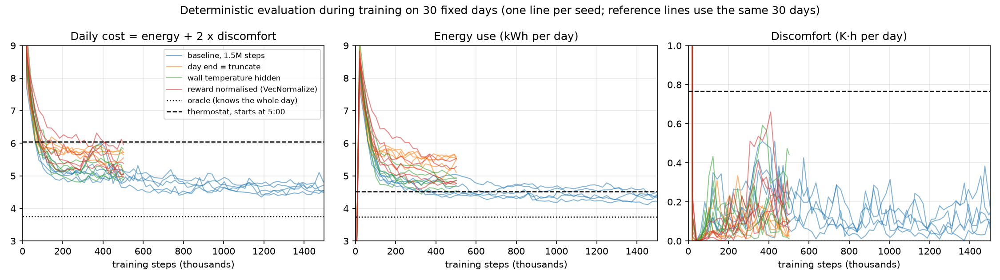
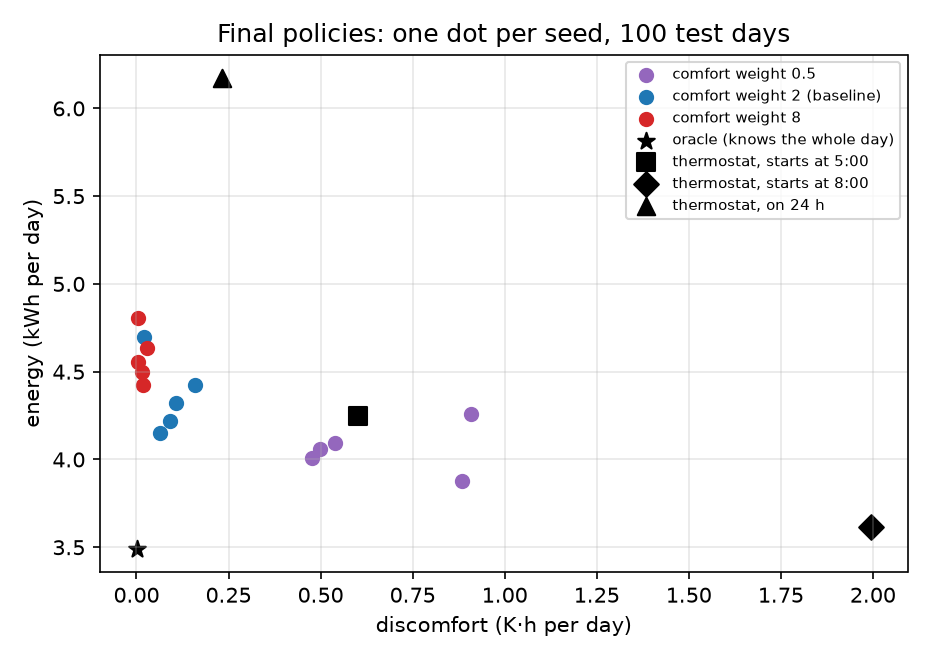
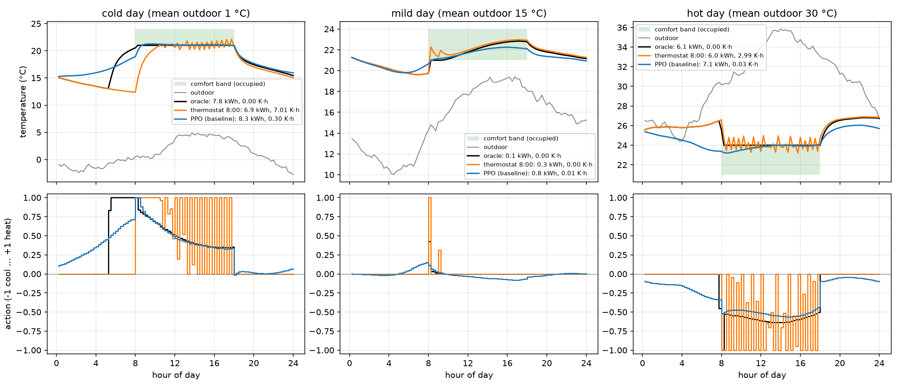

# 任务报告 task-20261124：环境设计与预实验

任务要求见 [instructions.md](../instructions.md)。本次只做环境和预实验，没有做 clip range / GAE lambda / epochs 的消融。

## 1. 结论

环境已经可用：PPO 用 SB3 默认超参数训练 50 万步，在 100 个测试日上的日均成本是 4.54（5 个种子，标准差 0.20），好于最好的规则温控器（5.45；后来补测提前 5 小时开机的温控器为 5.37），距离“提前知道全天天气”的理论最优（3.49）还有 30% 的差距。
这个差距正是后续消融需要的空间：环境既不是一学就满分，也不是学不动。

成本的定义是 `耗电量(kWh) + 2 × 不舒适度(K·h)`，下文所有“成本”都是这个数，越低越好。

## 2. 实际交付

| 文件 | 内容 |
| --- | --- |
| [hvac/env.py](../../../hvac/env.py) | 房间热模型环境 `RoomThermalEnv`（Gymnasium 接口），所有参数集中在 `RoomConfig` |
| [hvac/controllers.py](../../../hvac/controllers.py) | 不需要学习的对照控制器：关机、温控器、理论最优（线性规划） |
| [hvac/evaluation.py](../../../hvac/evaluation.py) | 在固定测试日上评估，输出能耗、不舒适度、违规比例 |
| [hvac/train.py](../../../hvac/train.py) | SB3 PPO 训练入口，记录训练曲线和 SB3 自带诊断量 |
| [tests/test_env.py](../../../tests/test_env.py) | 14 个测试 |
| [scripts/run_preexperiments.py](../../../scripts/run_preexperiments.py) | 预实验（8 组 × 5 个种子 = 40 次训练） |
| [scripts/analyze_preexperiments.py](../../../scripts/analyze_preexperiments.py) | 生成本报告的表和图 |
| [scripts/fit_initial_state.py](../../../scripts/fit_initial_state.py) | 初始温度分布的来源 |
| [scripts/energy_by_time_of_day.py](../../../scripts/energy_by_time_of_day.py) | 分时段能耗，用于 4.2 和 4.3 节 |
| [scripts/oracle_tradeoff.py](../../../scripts/oracle_tradeoff.py) | 用理论最优扫描舒适度权重和热泵容量，用于 4.5 节 |

复现命令（在仓库根目录）：

```bash
.venv/bin/python -m pytest -q
PYTHONPATH=. .venv/bin/python scripts/run_preexperiments.py --workers 8   # 约 12 分钟
PYTHONPATH=. .venv/bin/python scripts/analyze_preexperiments.py
```

## 3. 环境是怎么定义的，为什么

### 3.1 一句话版本

一间约 30 m² 的办公室，装一台既能制热也能制冷的热泵。
一个回合是一天（0 点到 24 点），每 15 分钟决策一次，共 96 步。
每个回合随机抽一天的天气，从日均 −2 °C 的冬天到日均 32 °C 的夏天都有。
智能体每步输出一个 −1 到 1 之间的数：负数制冷，正数制热，0 关机。
8 点到 18 点有人上班，这段时间室温应保持在 21–24 °C；其余时间没人，室温随意。
目标是全天用电尽量少，同时上班时间尽量不出舒适区。

### 3.2 热模型：两个温度

房间用两个温度描述：

- **空气温度**：人感受到的温度，变化快。热泵满功率开 15 分钟，空气升温约 2.2 °C。
- **墙体温度**：墙和楼板的温度，变化慢。满功率开 15 分钟只升 0.04 °C，但它的热容是空气的 10 倍。

两者之间、它们和室外之间都有热量交换，另外还有太阳辐射和人员设备的发热。
这类“几个热阻加几个热容”的模型在建筑领域叫 RC 灰箱模型（[Bacher & Madsen 2011](https://hal.science/hal-01305574v1/html_references#1)）。
模型的两个时间常数是 0.6 小时和 39 小时。

为什么要两个温度而不是一个：单个温度无法同时做到“空气反应快”和“墙体储热慢”。
（2026-11-24 更正：初版写的是“只有一个温度时最优策略就是普通温控器”，这个说法没有验证过，后来的对比也不支持它。在墙体不储热的单温度房间里，8 点才开机的温控器成本是 12.85，理论最优是 2.97，同样需要提前开机。对比数据见 `scripts/make_environment_figures.py` 的输出和正式报告 1.6 节。）
加上慢的墙体后，冬天早上墙是冷的，8 点才开机根本来不及，必须提前几小时预热。
这就让“现在的动作，几小时后才见效”成为问题的核心，而 GAE lambda 恰好控制 PPO 把多久以后的奖励归功于现在的动作。

模型是线性的，所以用矩阵指数做了精确离散化，15 分钟一步没有数值积分误差（测试里和 0.5 秒步长的欧拉积分对过，误差小于 0.001 °C）。

### 3.3 MDP 各部分

| 部分 | 定义 | 理由 |
| --- | --- | --- |
| 观测（7 维） | 空气温度、墙体温度、室外温度、太阳辐射、是否有人、一天中的时刻（sin、cos 两个数） | 都缩放到大约 −1 到 1。时刻必须给，否则智能体不知道离上班还有多久 |
| 动作（1 维连续） | −1 到 1，乘以 3 kW 得到制热/制冷量 | 一个动作同时覆盖冷热两种季节，最简单 |
| 奖励 | 每步 `−(本步耗电 kWh + 2 × 本步不舒适度 K·h)` | 见下 |
| 回合结束 | 24 点整，按“真正结束”处理 | 见 4.2 节 |
| 初始状态 | 0 点的墙体温度 = 16.3 + 0.33 × 当日室外均温 ± 1 °C | 冬天墙冷、夏天墙热。系数来自让同一种天气连续重复 6 天后的午夜温度 |

**不舒适度**的算法：有人时，空气温度超出 21–24 °C 多少度，乘以持续时间，单位 K·h。
比如上班时间室温 20 °C 持续 1 小时，就是 1 K·h。
舒适区间和 K·h 这个单位沿用建筑控制基准 BOPTEST 的约定（[BOPTEST KPI 定义](https://beta.escholarship.org/content/qt7xb9g6hv/qt7xb9g6hv.pdf?t=r3jcl6#4#7#4)）。
“能耗和不舒适度加权求和”的奖励形式沿用 Sinergym 的线性奖励（[Sinergym 文档](https://sinergym.readthedocs.io/en/stable/pages/rewards.html)）。

权重取 2 的含义：1 K·h 的不舒适等价于 2 kWh 的电，也就是热泵满功率开 2 小时。

**报告用的三类指标**都由环境直接给出，和奖励用的是同一套量：

- 能耗：每天耗电 kWh。
- 舒适度违规：每天不舒适度 K·h；以及上班时间里超出舒适区 0.1 °C 以上的步数比例。
- 训练稳定性：训练过程中每 2 万步在 30 个固定测试日上评估一次，另外记录 SB3 的 `approx_kl`、`clip_fraction`、`explained_variance`。

### 3.4 对照控制器

| 控制器 | 做法 | 用途 |
| --- | --- | --- |
| 关机 | 永远不开 | 最差参照 |
| 温控器 | 冷了就热、热了就冷，可设置提前几小时开机 | 不用强化学习时的常规做法 |
| 理论最优 | 提前知道全天天气，用线性规划解出最优动作 | 成本下界 |

理论最优不是公平的对手：它知道未来天气（包括随机扰动），智能体不知道。
所以 PPO 和它之间的差距有一部分原则上追不上，这部分有多大我没有测。

### 3.5 对 PPO 的主要挑战

1. **动作的后果来得晚。** 早上 5 点预热，好处在 8 点以后才体现，中间隔了十几步。
2. **最优点贴着惩罚的边缘。** 最省电的做法是冬天把室温刚好压在 21 °C。PPO 训练时动作带随机噪声，一抖就掉出舒适区挨罚。训练曲线里不舒适度一直在 0 到 0.5 K·h 之间跳动，就是这个原因。
3. **一个策略要应付所有天气。** 同一个网络既要会冬天预热，也要会夏天制冷，还要在春秋天学会什么都不做。
4. **两项成本量级悬殊。** 未训练的策略成本约 76（30 个曲线评估日），其中几乎全是不舒适度；训练后降到 5 以下，其中几乎全是能耗。学习的前期和后期实际在优化不同的东西。

## 4. 预实验结果

所有训练都用 SB3 默认超参数（clip range 0.2、GAE lambda 0.95、10 个 epoch），每组 5 个种子，除注明外都是 50 万步。
最终策略在 100 个固定测试日上评估，测试日和训练日的随机种子不重叠。

### 4.1 对照控制器

| 控制器 | 能耗 kWh/天 | 不舒适度 K·h/天 | 违规步数比例 | 成本 |
| --- | --- | --- | --- | --- |
| 关机 | 0.00 | 35.15 | 82.9% | 70.31 |
| 温控器，8 点开机 | 3.62 | 1.99 | 21.1% | 7.60 |
| 温控器，6 点开机 | 4.06 | 0.79 | 15.1% | 5.65 |
| 温控器，5 点开机 | 4.25 | 0.60 | 12.9% | 5.45 |
| 温控器，24 小时开 | 6.17 | 0.23 | 7.1% | 6.64 |
| 理论最优 | 3.49 | 0.00 | 0.0% | 3.49 |

温控器的结果说明环境确实需要“提前量”：8 点才开机成本 7.60，提前到 5 点降到 5.45，但 24 小时全开又升回 6.64。

### 4.2 PPO 各组结果

成本一栏统一按权重 2 计算，方便横向比较。

| 组别 | 能耗 | 不舒适度 | 违规步数比例 | 成本（均值 ± 标准差） | 5 个种子的成本范围 |
| --- | --- | --- | --- | --- | --- |
| **基线** | 4.36 | 0.09 | 2.8% | 4.54 ± 0.20 | 4.28 – 4.74 |
| 回合结束按“截断”处理 | 5.13 | 0.03 | 0.7% | 5.19 ± 0.21 | 4.83 – 5.33 |
| 舒适度权重 0.5 | 4.06 | 0.66 | 15.4% | 5.38 ± 0.47 | 4.96 – 6.08 |
| 舒适度权重 8 | 4.58 | 0.01 | 0.5% | 4.61 ± 0.14 | 4.46 – 4.81 |
| 隐藏墙体温度 | 4.56 | 0.12 | 4.4% | 4.81 ± 0.34 | 4.54 – 5.41 |
| 奖励整体 × 0.1 | 5.07 | 0.04 | 1.4% | 5.15 ± 0.26 | 4.76 – 5.48 |
| 奖励归一化（VecNormalize） | 4.80 | 0.05 | 1.7% | 4.91 ± 0.41 | 4.60 – 5.56 |
| 基线，训练 150 万步 | 4.10 | 0.07 | 1.7% | 4.23 ± 0.09 | 4.13 – 4.34 |



逐条说明：

- **回合结束方式影响明显。** “截断”比“真正结束”成本高 0.65，两组的种子范围不重叠。
  原因：按截断处理时，SB3 会把“午夜这个状态以后还值多少”加到最后一步的奖励上，智能体于是为“明天”保养房间。
  分时段能耗证实了这一点：18 点下班后，截断组平均还用 0.44 kWh，基线组只用 0.10 kWh，理论最优是 0。
  我们评估的是单日成本，所以默认采用“真正结束”。这对应 [Pardo et al. 2018](https://icml.cc/virtual/2018/poster/2463) 讨论的第一种情形：任务本身就是固定时长，并且把时间放进观测。
- **舒适度权重是有效的调节旋钮。** 权重从 0.5 到 2 到 8，不舒适度从 0.66 降到 0.09 再到 0.01，能耗从 4.06 升到 4.36 再到 4.58。
  
- **隐藏墙体温度：没有定论。** 均值差 0.27，但主要来自一个种子（5.41），其余 4 个种子和基线范围重叠。默认保留墙体温度可见。
- **奖励缩小到 0.1 倍变差了。** 成本高 0.61，种子范围和基线不重叠。原因我没有查。VecNormalize 的结果介于两者之间，和基线范围重叠。默认不做奖励缩放。
- **50 万步没有完全收敛。** 训练到 150 万步成本从 4.54 降到 4.23，种子间的标准差从 0.20 降到 0.09。

### 4.3 PPO 学到了什么



图中 PPO 是基线组里成本居中的那个种子。

- 冷天：PPO 学会了提前预热，8 点前室温已接近 21 °C；温控器 8 点才开机，上午一直不达标。
- 白天：PPO 的动作和理论最优几乎重合，把室温贴着舒适区边缘。
- PPO 和理论最优的差距几乎全部在 8 点以前：这段时间 PPO 平均用 1.51 kWh，理论最优用 0.64 kWh，差 0.87 kWh；两者全天能耗相差也是 0.87 kWh（8 点以后的时段两者相差不到 0.1 kWh）。
  理论最优是到点前满功率猛开一阵，PPO 是从半夜起小功率慢慢开，后者更费电。

### 4.4 对后续消融有用的观察

- 基线训练中 `clip_fraction` 从前期的 6% 升到后期的 20%，`approx_kl` 从 0.007 升到 0.021。裁剪确实在起作用，改 clip range 应该会有可见的影响。
- 值函数拟合得不错：`explained_variance` 前期 0.90，后期 0.99。
- 策略的动作标准差从 1.0 降到约 0.03，后期基本不再探索。
- 单次训练 50 万步约 85 秒（8 个训练并行，10 核 M5）。

### 4.5 舒适和能耗的冲突在哪里（2026-11-24 补充，更正了初版的说法）

初版报告写的是“舒适和能耗在最优解里几乎不冲突”，这个说法不准确，更正如下。

冲突是存在的：完全不开机时不舒适度是 35.15 K·h，把它消除到 0 需要 3.49 kWh。
平均下来，消除 1 K·h 的不舒适只需要约 0.1 kWh 的电。
我们的权重是 2，也就是把 1 K·h 定价为 2 kWh，是这个“实际价格”的 20 倍，所以最优解自然是把舒适全买下来。

下表只用理论最优（不涉及任何训练），在 100 个测试日上改变权重：

| 舒适度权重 | 能耗 kWh/天 | 不舒适度 K·h/天 | 违规步数比例 |
| --- | --- | --- | --- |
| 0.05 | 0.00 | 35.15 | 82.9% |
| 0.075 | 0.41 | 29.61 | 80.0% |
| 0.1 | 2.06 | 10.21 | 47.0% |
| 0.15 | 3.05 | 1.80 | 13.8% |
| 0.2 | 3.20 | 0.91 | 8.6% |
| 0.3 | 3.34 | 0.29 | 3.8% |
| 0.5 | 3.44 | 0.06 | 1.0% |
| 1 | 3.47 | 0.02 | 0.5% |
| 2（默认） | 3.49 | 0.00 | 0.0% |
| 8 | 3.49 | 0.00 | 0.0% |

权重在 0.075 到 0.5 之间时，最优解里两项都不为零，是真正的此消彼长；权重 1 以上，最优解停在“舒适全满足”的一端。
所以准确的说法是：**我们的环境有冲突，只是默认权重 2 选在了舒适优先的那一端。**

另外两个会让冲突变明显的因素，同样用理论最优在权重 2 下验证：

| 改动 | 能耗 kWh/天 | 不舒适度 K·h/天 |
| --- | --- | --- |
| 默认（热泵 3000 W） | 3.49 | 0.00 |
| 热泵 2000 W | 3.71 | 0.05 |
| 热泵 1500 W | 3.76 | 0.80 |
| 热泵 1000 W | 3.45 | 5.34 |
| 全天 24 小时都要求舒适 | 5.15 | 0.25 |

热泵变小后，即使知道全天天气也无法保证舒适。
全天要求舒适只是让能耗升高；那 0.25 K·h 全部出现在 0 点到 3 点，来自午夜初始温度本身就在舒适区外，不是权衡的结果。

**文献里的情况。** 最接近我们设定的是 [Manjavacas et al. 2024](https://arxiv.org/html/2401.05737v3)：同样用 Sinergym 的线性奖励（能耗和超出舒适区的温差加权求和，默认各占 50%），算法里包括 PPO。
他们的做法是用不同权重各训练一个智能体，比较结果，得到的结论是：

- 提高舒适权重会减少违规，并且“在多数情况下”增加能耗。
- 但在 5ZoneAutoDXVAV 建筑里，“改善舒适对能耗影响不大”，存在“显著改善舒适而几乎不增加能耗”的情况。这和我们环境的性质相同。
- 权重怎么选“完全取决于具体问题和环境”。
- 继续加大舒适权重后违规不再下降，他们归因于智能体的能力有限。

需要注意的是，他们比较的是训练出来的智能体，没有理论最优作参照，所以无法区分“建筑本身要求取舍”和“智能体没学好”。我们有理论最优，能把这两者分开。

另一篇综述（[Energy and Buildings 2025](https://www.sciencedirect.com/science/article/pii/S0378778825011697)，我只读到了摘要和要点，正文打不开）统计了 79 篇论文，发现 68 种不同的奖励设计，并指出这些设计依赖缺乏理论依据的权重系数。

## 5. 验证

- `pytest`：14 个测试全部通过。覆盖 Gymnasium 和 SB3 的接口检查、同种子可复现、离散化精度、无输入时趋于室外温度、制热升温制冷降温、奖励与上报指标一致、无人时段不计不舒适度、满功率一天的耗电量等于额定值、理论最优不差于任何规则控制器。
- 40 次预实验训练全部正常结束。
- 4.5 节的两张表由 `scripts/oracle_tradeoff.py` 直接输出。
- 三张图都已目视检查。

## 6. 待解决事项

1. **舒适度权重取多少，需要你来定。** 默认权重 2 下最优解是“舒适全满足”，违规只来自智能体的控制误差（见 4.5 节）。
   如果希望最优解本身就包含取舍，可以把权重降到 0.2 到 0.3。这个区间我没有训练过 PPO；最接近的是权重 0.5，那一组 PPO 的不舒适度是 0.66 K·h，而理论最优只有 0.06 K·h。
   初版提到的“加峰谷电价”不再需要。
2. **正式消融的训练步数没定。** 50 万步时策略还在变好，150 万步更稳但耗时 3 倍。
3. **奖励 × 0.1 为什么变差没有查明。**
4. **隐藏墙体温度的影响需要更多种子才能下结论。**
5. **PPO 与理论最优的差距里有多少是“不知道未来天气”造成的，没有测。**
6. 简化之处：无人时段完全不计不舒适度（BOPTEST 在无人时仍要求 15–30 °C）；热泵效率固定为 3，不随室外温度变化；电价全天相同；每天独立，初始温度由公式给出而不是前一天留下的。
7. 工作目录不是 git 仓库，目前没有版本管理。
